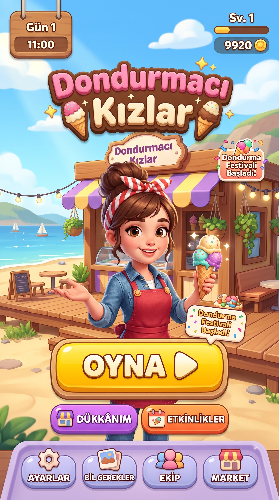
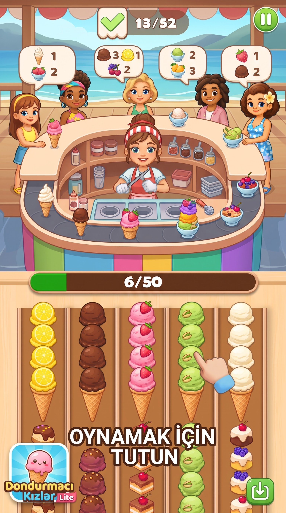
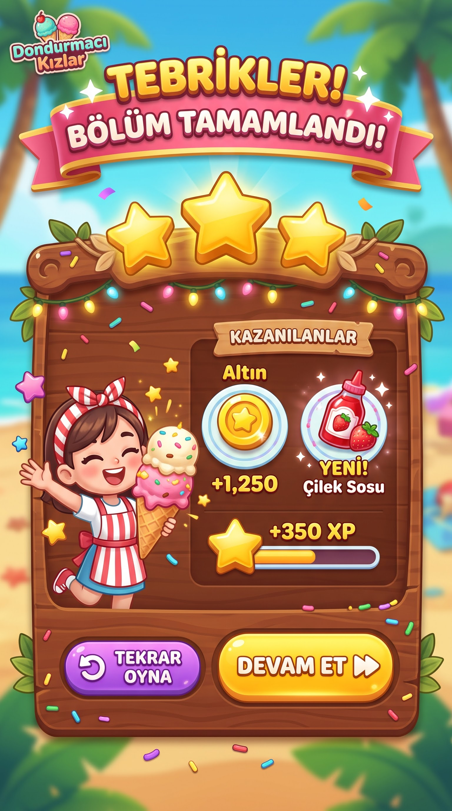
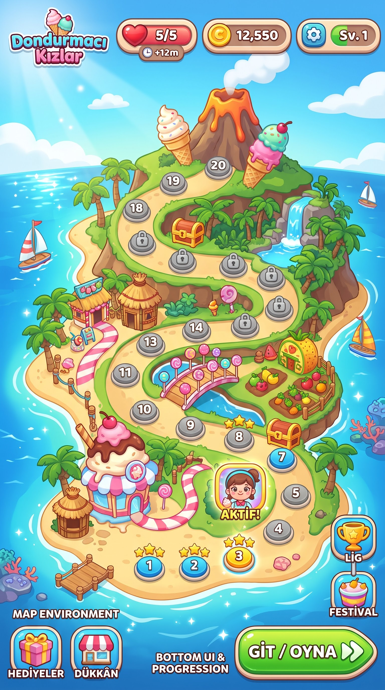

# DK Lite — Oyun Tasarım Belgesi

**Proje:** DK Lite (Kems Company)
**Aşama:** Tasarım kararları verildi (Kemal, 21 Ekim 2026). 1.–5. paket (çizimsiz deneme oyunu, erime kuralı, sayaçlar ve bölüm sonu, numaralı bölümler, çizimsiz bölüm haritası) ve gece işleri (renk, giriş ekranı, duraklatma, hızlandırma, 10 bölüm ve daha yavaş zorluk; 0.10) bitti, ana dala birleşti. Kemal'in 22 Ekim akşamı harita ve hız cevapları işlendi (0.12; 28 Ekim 2026, öneri). Oyun ekranına Dondurmacı Kızlar görselleri kondu (0.13; 29 Ekim 2026). Oyun ekranının yeni hâli için soru turu yapıldı (0.14; 29 Ekim 2026). Sonraki kararlar 0.23'e kadar aşağıda işlendi (5 Kasım 2026 itibarıyla).
**Depo:** `hkemal94/DK-Lite`
**Yazan:** Oyun Şefi (Kems Ajans). Onay Kemal'in.
**Yol haritası:** `docs/yol-haritasi.md`

Ne istendi (21 Ekim 2026): belgeyi Kemal'in panodaki üç cevabıyla son hâline
getirmek. Kod yok.

Bakılan kaynaklar:
- Kemal'in panodaki cevapları (21 Ekim 2026; CEO iletti)
- Kems-Ajans deposunda `isler/dk-lite/kkm-oyun-dosyasi-21-10-2026.pdf` ve `isler/dk-lite/is-tarifi.md` (ilk taslakta okundu)
- KKM: `docs/02-marka-kiti.md`, `docs/03-duzada-kunyesi.md`
- Dondurmacı Kızlar deposu: `CLAUDE.md`, `docs/tasarim-belgesi.md` (yalnız okundu)
- Kemal'in taslak ekranları: `docs/gorseller/kemal-taslak/`

Ulaşılamayan: örnek oyunun (Tasty Travels) ekran görüntüsü depoda yok;
yalnız iş tarifindeki yazılı anlatım kullanıldı.

Okuma kuralı: "[Kemal]" yazan yer Kemal'in dolduracağı boş alandır. "Öneri"
yazan her şey seçenektir, karar değildir. Hiçbir ad, slogan ya da hikâye
yazılmadı. Dondurmacı Kızlar oyununun ayarları (fiyat, süre, oran) buraya
taşınmadı. Bölüm 0 belgenin geri kalanıyla çelişirse bölüm 0 geçerlidir.

---

## 0. Kararlar

En yeni karar en üstte. Çelişen yerde en yeni karar geçerlidir.

### 0.45 Telefonun geri tuşu (Kemal, 9 Kasım 2026; öneri)

- **Sorun** (Kemal: "Geri tuşuna basınca komple sayfada geri gidiyor onu istemiyorum, bir önceki menüye dönebileyim"): geri tuşu oyundan çıkıp tarayıcıda önceki sayfaya gidiyordu.
- **Şimdi geri tuşu:** açık pencereyi kapatır (albüm, mağaza, ayarlar, rozet; ödül penceresinde "Tamam" gibi davranır); Bölümler ekranından giriş ekranına döner; oyun sürerken duraklatır, duraklatma menüsündeyken oyuna döner; bölüm sonunda ana sayfaya döner. Giriş ekranında bir şey yapmaz; oyundan çıkmak için tarayıcının sekmesi kapatılır.
- Telefon benzetimiyle denendi. Gerçek telefonda denenmedi; bazı tarayıcılar art arda çok hızlı basılan geri tuşunu farklı işleyebilir.

### 0.44 Kompakt ekranlar, rozet simgeleri, tema simgeleri (Kemal, 9 Kasım 2026; öneri)

- **Kompakt** (Kemal: "bu kadar altlara kadar yayılmak zorunda değil derdim kompakt olsun her şey"): 0.43'teki "pencere ekranı doldursun" ve giriş ekranının büyümesi geri alındı. Giriş ekranı eski toplu hâlinde; albüm ve mağaza pencereleri içerikleri kadar. Eksik son satırı son kutunun doldurması kaldı. Kalıcı kural da buna göre yazıldı: ekranlar dolu ve derli toplu, içlerinde boş delik yok ama ekrana yayılmazlar.
- **Rozetler** (Kemal: "yalnızca birer ikon ekleyelim üzerine basıldığında açıklamaları görünsün, ikonlar kilitliyken ... sansürlü gibi blurlu olsun"): albümde yalnız simgeler var: bayrak, kişi, kalabalık, yıldız, taç, alev, şimşek, harita iğnesi, külah, kupa, takvim, elmas (simgeleri ekip seçti). Dokununca rozetin adı, ödülü ve "Alındı" ya da "Kilitli" yazan pencere açılır. Kilitli rozetin simgesi bulanık.
- **Tema simgeleri** (Kemal: "kışta kar taneleri, yazda güneş, sonbaharda yaprak, gecede ay"): tema örneklerinde yarı saydam simge var: Gece ay, Sonbahar yaprak, Deniz güneş, Kış kar tanesi; Dükkân külah, Pamuk şeker şeker (ikisini ekip seçti).
- Görüntü: `docs/ekran/koleksiyon/kompakt-rozet-tema.png`. Gerçek telefonda denenmedi.

### 0.43 İki kostüm, Kış teması, ev simgesi, lokasyon kartları, dolu ekranlar (Kemal, 9 Kasım 2026; öneri)

- **Kızın iki yeni kostümü** (Kemal seçti): Kışlık (bere, atkı, kazak) ve Yazlık (hasır şapka, çiçekli elbise); 800 para (DENEME). Canva, dondurmacı çizimi örnek verilerek; arka planı Canva'da silindi; "DK Lite çalışma" tasarımının 25. sayfası.
- **Kış teması** (Kemal seçti): buz mavisi zemin, kar taneleri; bant, bar duvarı, üst şerit ve sütunlar temaya uyar, tente mor-sarı kalır; 500 para (DENEME).
- **Ev simgesi** (Kemal: "çatıyla ev aynı renk olsun o aradakini beğenmedim"): çatı ve gövde tek parça, aynı renk.
- **Lokasyon kartları** (Kemal: "ekrana sığacak şekilde 3 veya 4"; "kartların bir mantığı olsun"; seçim "Lokasyon kartı + ödül"): albümde 3'erli dizilir, 10 kart ekrana sığar. Lokasyonun 30 bölümü bitince kart açılır, "Yeni kart!" penceresi çıkar ve 150 para verir (DENEME). Kartta o lokasyonda kazanılan ürünler (en çok 3) ve lokasyonun yıldızı (ör. 72/90) yazar; 90/90 olunca kart altın çerçeveli ve parlak olur. Kartlar gelmeden önce bitirilen lokasyonların kartı ve parası oyun açılınca bir kez verilir.
- **Ekranda boşluk kalmasın** (Kemal: "Ekranlarda boşluk kalmaması ve dolu olması benim için önemli"; kalıcı kural): albüm ve mağaza penceresi ekranın boyunu doldurur, içindeki kutular ve resimler kalan yere göre büyür; son satır eksik kalırsa son kutu kalan yeri kaplar (10. kart, can). Giriş ekranında logo ve düğmeler ekranın boyuna göre büyür. Görüntü: `docs/ekran/koleksiyon/dolu-ekranlar.png`.
- Görüntü: `docs/ekran/koleksiyon/kostum-tema-kart.png`. Gerçek telefonda denenmedi.

### 0.42 iPhone'da oyun büyümesin, yıldız kilidi toplanarak (Kemal, 9 Kasım 2026; öneri)

- **Sorun** (Kemal: kardeşinin iPhone'unda 2. bölümde ekran büyüdü, görüntü): iPhone'un tarayıcısı sayfadaki "yakınlaştırma kapalı" ayarını dinlemiyor; iki parmakla ya da sütunlara hızlı çift dokunuşla sayfa büyüyor.
- **Çözüm:** iki parmakla büyütme ve hızlı çift dokunuşla büyütme oyunda kapatıldı. Sütunlara ve düğmelere hızlı art arda dokunuşlar yine sayılıyor (telefon benzetimiyle denendi).
- Gerçek iPhone'da denenmedi; bilgisayardaki benzetim iPhone'un büyütmesini birebir yapmıyor.
- **Yıldız kilidi toplanarak** (Kemal: "yıldız kilitlerini toplayarak ilerletelim"): sonraki lokasyon artık bütün bölümlerden toplanan yıldızla açılır. 2. lokasyon 75, 3. lokasyon 150, 4. lokasyon 225 ... toplam yıldızla (her lokasyon için 75, DENEME). Bir lokasyonda fazla toplanan yıldız sonrakine sayılır. Kilit penceresi yıldızı az olan bölümleri bütün açık lokasyonlardan önerir. Eskiden her lokasyon yalnız bir öncekinin 75 yıldızıyla açılıyordu; yeni kural hiçbir açık lokasyonu kilitlemez.

### 0.41 Hedef biraz daraldı, karakter kenarları temizlendi (Kemal, 9 Kasım 2026; öneri)

- **3 yıldız hedefi** (Kemal: "Fazla kolay oldu bu sefer"; seçim "Geçen seferki %15'in 10'unu geri al"): hedef genişliği %15'ten %5'e indi (DENEME). Hamle sınırı hedefin 2 katı olduğu için o da biraz daralır. Otomatik oyuncu: dikkatli oynayan 1, 10, 15, 23. bölümde 3 yıldız, 40'ta 2 yıldız; rastgele basan 1 yıldız.
- **Karakterlerin kenarı** (Kemal: "siyah arkaplanda beyaz beyaz görünüyor"): ilk 10 müşterinin dış çizgisinin dışında çıkartma gibi beyaz bir şerit vardı; silindi. Bütün müşterilerde ve dondurmacı kızın resimlerinde yarı saydam kenarın beyazı da temizlendi (`araclar/kenar_temizle.py`; müşteri resimleri `musteri_isik.py` ile yeniden üretilir). Beyaz giysi ve ayakkabılara dokunulmadı. Görüntü: `docs/ekran/koleksiyon/musteri-kenar-once-sonra.png`.
- Gerçek telefonda denenmedi.

### 0.40 Sipariş balonu, mağaza sekmeleri (Kemal, 9 Kasım 2026; öneri)

- **Sipariş balonundaki koyu yuvarlaklar** (Kemal: "bunları kaldır"): iki çeşit isteyen müşterinin balonundaki küçük adet işareti, yeni rozetlerin görünüşünü almıştı (aynı adı taşıyordu); düzeldi, balonda yine küçük "×2" işareti var.
- **Mağaza ve albümde sekme değişince** pencere yeniden açılır gibi olmuyor; yalnız içi değişir.
- **"Yakında" sekmesi kaldırıldı** (Kemal: "onu yalnızca biz bilelim"): ürün kaplamaları, müşteri kaplamaları, oyun temaları sonraki iş olarak burada durur; oyuncu görmez. Mağazada üç sekme kaldı (Temalar, Kostüm, Yardım), yazıyla sığıyor; simgeye gerek olmadı.
- **Eski yıldızların parası** (Kemal: "Bir kerelik ver"): para gelmeden önce toplanan her yıldız için oyun açılınca bir kez 10 para (DENEME) verilir. 0.39 ile 0.40 arasında oynanan bölümlerin yıldızları iki kez sayılabilir (birkaç yıldız).
- **Temalar daha belirgin** (Kemal: "Tente ve tezgâh da değişsin"; "barın içindeki duvar rengi değişebilir"): tema; bant, barın içindeki duvar, üst şerit ve sütunların rengini de değiştirir. Tente ve tezgâhın önündeki mor-sarı çizgiler marka rengi, hiçbir temada değişmez (Kemal: "Tentelerin mor sarı çizgisi değişmesin onlar marka rengi"). Pencereler ve düğmeler aynı kalır. Renkleri ekip seçti. Görüntü: `docs/ekran/koleksiyon/temalar-oyunda.png`.
- Gerçek telefonda denenmedi.

### 0.39 Para, mağaza, rozetler, kartpostallar, İngilizce, kostümler (Kemal, 9 Kasım 2026; öneri)

- **3 yıldız kolaylaştı** (Kemal: "Hedef %15 büyüse yeter gibi"): hamle hedefi %15 büyüdü.
- **Bir bölümde en çok 6 çeşit** (Kemal: "6 kalsın, yeniler sık gelsin"): son açılan 3 ürün bölümlerin yaklaşık %78'inde çıkıyor.
- **"Başla" kaldığı yerden:** 0. bölüm gelmeden önce oynamaya başlayanlar artık 0. bölüme dönmüyor.
- **Albüm sürpriz:** kilitli ürünün kaçıncı bölümde açılacağı yazmıyor; yalnız "?".
- **Para** (adı [Kemal]): yeni yıldız başına 10, sandıktan 20 ya da 50, günlük ödülden 25 (7. gün 100), rozetlerden 50–200. Ana sayfada can göstergesinin altında durur.
- **Mağaza:** arka plan temaları (Dükkân, Gece, Sonbahar, Deniz, Pamuk şeker; 500), dondurmacı kızın kostümleri (Maraş dondurmacısı, Denizci, Aşçı; 800), yardımcılar (100), can (80; en çok 6). "Yakında" sekmesi: ürün kaplamaları, müşteri kaplamaları, oyun temaları (Kemal: "şu an için sadece yolu açılsın"). Tema ve kostüm adları [Kemal]; Denizci ve Aşçı'yı ekip seçti.
- **Maraş dondurmacısı adam iptal** (Kemal: "Maraş dondurmacısı iptal olsun kızlar olsun çalışan ilk etapta sürekli olarak"; "Kızın kostümleri olsun satılan"): tezgâhta hep kız; kostümleri satılır. Canva, 24. sayfa.
- **Rozetler (12, Kemal "Uygun"):** 0. bölüm, 100 / 1000 müşteri, 10 / 50 bölüm 3 yıldız, 5 / 10 üst üste galibiyet, bir lokasyonda bütün yıldızlar, 10 ürün / bütün ürünler, 7 gün art arda, boşa top göndermeden bitir. Kazanınca pencere ve para; bazıları yardımcı ya da can da verir.
- **Lokasyon kartpostalları (10):** lokasyondaki bütün bölümler bitince açılır; albümde "Kartlar" sekmesi.
- **İngilizce** (Kemal: "Ayarlarda dil seçimi: Türkçe / English"): ayarlarda dil seçimi; telefonun dili Türkçe değilse ilk açılışta İngilizce. Yer adları çevrilmez. Çeviriler ekibin; Kemal görür.
- **Müşteri ışığı** (Kemal: "Hepsine aynı ışık ayarı"): 21 kişiye aynı üstten ışık ve aynı vurgu (`araclar/musteri_isik.py`); renk ve desen çeşitleri yeniden üretildi.
- **Dondurmacı:** kolun içindeki ve boyundaki beyaz lekeler temizlendi.
- **Bar arka planı daha albenili:** pastel çizgili duvar, sıcak ışık, üstte renkli bayrak dizisi, kalın raf.
- Sayıların hepsi DENEME. Ekran görüntüleri `docs/ekran/koleksiyon/`. Ekran denetimi Türkçe ve İngilizce, iki telefon boyutunda sorunsuz. Gerçek telefonda denenmedi.

### 0.38 Tente, 300 bölüm, 10 lokasyon, 23 hediye (Kemal, 9 Kasım 2026; öneri)

- **Tente** (Kemal: "Alttaki açık lila şerit" rahatsız ediyor; "mor sorun yaratmayacak mı"): koyu mor üst şerit dilimlerin arkasına uzandı, aradan açık zemin görünmez; dilimlerin altında koyu kahve kenar, mor dilimler mor şeride karışmaz.
- **300 bölüm, 10 lokasyon** (Kemal: "300 bölüm yapalım o zaman 10 adet lokasyon olsun şimdilik isimleri lokasyon 6, lokasyon 7 gibi ilerlet"): her biri 30 bölüm; 6–10'un adı şimdilik "Lokasyon 6" … "Lokasyon 10" [Kemal]. Renkleri ekip seçti: lacivert, hardal, mercan, lavanta, çam yeşili. Mahalle kilidi (75 yıldız) hepsinde geçerli. Yeni zorluk öğesi yok (Kemal: "var olanlar yeter").
- **Yeni 8 ürün** (Kemal seçti): karadut ve kavun dondurma, vişne suyu, buzlu kahve, kazandibi, künefe, ayva tatlısı, waffle. Canva (kaynak `docs/lisanslar.md`). Toplam 26 ürün: 3 başlangıç + 23 hediye.
- **Hediyeler baştan artarak dağıldı** (Kemal: "10'da bir devam etmeyelim ... arttırarak"; "Baştan artarak dağıt"): 0, 5, 11, 17, 25, 33, 42, 51, 62, 73, 85, 98, 111, 126, 141, 157, 174, 191, 209, 228, 248, 269, 290 (aralık 5'ten 21'e; DENEME). Sandık her 10 bölümde devam eder.
- **Aynı anda kaç ürün:** bir bölümde en çok 6 çeşit gelir (zorluk ayarı); 26 ürün aynı bölümde gelmez. 0–300 bölümün hepsi kazanılabilir kuruluyor (çözücüyle denendi); her hediye ertesi bölümde mutlaka gelir.
- Ekran görüntüleri: `docs/ekran/300-bolum/`. Gerçek telefonda denenmedi.

### 0.37 Müşteri tonları, ince yardımcı şeridi, siparişler yan yana (Kemal, 6 Kasım 2026; öneri)

Kemal telefonda (yaklaşık 450x1000, Bölüm 14) üç şey gördü ve çözümleri seçti.
- **Müşteri tonları** ("önce eşitle"): çizimler aynı kaldı, yalnız tonlar eşitlendi. Her kişinin beyaz bölgelerinin rengi (krem ile kar beyazı arası kırık beyaz), çizgilerinin koyuluğu, genel parlaklığı ve renk canlılığı ölçüldü ve ortak bir hedefe çekildi; saydam kenarlar aynı. Bir kişinin düzeltmesi onun bütün renk ve desen çeşitlerine de uygulandı (89 resim). Parlaklık ve canlılık kıyafete ve tene de bağlı olduğu için (siyah tişört, açık mavi elbise) bu ikisi sınırlı çekildi; tam eşitleme çizimi bozardı. Araç: `araclar/musteri_ton.py` (`olc` yalnız ölçer, `esitle` düzeltir; eşitlenen dosyaya ikinci kez dokunmaz, kayıt `araclar/musteri_ton_kayit.json`). Orijinaller git geçmişinde.
- **Yardımcı düğmeleri** ("ince şerit"): alttaki 5 düğme eskisinin yaklaşık yarı boyu (46 px'ten 26 px'e), tek ince sıra; sayı rozetleri duruyor; dokunma alanı görünmez kenarla 44 px. Şerit 26 px kısaldı, yer sütunlara gitti; sütundaki dondurmaların üst sınırı 54 px'ten 68 px'e çıktı (450x1000'de 50 px'ten 64 px'e büyüdü).
- **Siparişler yan yana** ("siparişler yan yana"): iki çeşit isteyen müşterinin siparişleri balonda yan yana; kalan adet simgenin köşesinde küçük mor rozet. Balon herkeste aynı yükseklikte, bütün müşteriler aynı boyda görünür (önceden iki siparişli müşteri 32 px aşağıda kalıyordu). Tek siparişli balon eskisi gibi (simge ve yanında "×4").
- Üç ve dört çeşit oyunda şimdilik yok (bölümler en çok iki çeşit kuruyor). Elle denendi: üç çeşit 450 genişlikte okunuyor ama simgeler küçük (17 px), 360 genişlikte rozetler sıkışık; dört çeşit okunmuyor. İleride üç çeşit gelirse balonun genişlemesi gerekir ([Kemal] kararı).
- Bilgisayarda telefon boyutunda (450x1000, 390x844, 360x640) denendi; gerçek telefonda denenmedi. Ekran görüntüleri: `docs/ekran/ton-dugme-balon/`.

### 0.37 Hamle ve puanlama (Kemal, 9 Kasım 2026; öneri)

Kemal: "Bölümlerde hamle sayısının hiç önemi yok, sürekli bir şeylere basarak da bölüm geçilebiliyor ... sürekli 3 yıldız alınıyor." Ölçüm: rastgele dokunan otomatik oyuncu 1, 5, 10, 15, 25 ve 40. bölümleri 3 yıldızla geçti (yıldız yalnız puana bakıyordu, boşa dokunuşun bedeli yoktu). Kemal'in seçimi: üçü birlikte ("Hepsi olur"), eşik "Rahat", sınır "Hedefin 2 katı, 11. bölümden", hamle bitince "+5 hamle".
- **Hamle:** top gönderme ve buz kırma. Yardımcı kullanmak ve sallanma (bant dolu, kilitli sütun) sayılmaz.
- **Hedef hamle:** her bölümde oyun kendisi hesaplar: bölümü kuran çözücünün bulduğu yolun hamlesi + buz kırma dokunuşları, × 1,1 + 2 (DENEME). Örnek: 1. bölüm 39, 10. bölüm 87, 40. bölüm 166.
- **Sayaç:** üst şeritte sayaçlar 2x2 (Kemal: "2 2 yap altlı üstlü"): üstte müşteri ve puan, altta hamle ("23/39") ve bant. Hedef aşılınca turuncu, 1 yıldıza düşünce kırmızı; sınırlı bölümde son 10 hamlede "Son 7" gibi kalan hamle.
- **Yıldız:** üç yıldızın en düşüğü: hamle yıldızı (hedefe kadar 3, hedefin 1,5 katına kadar 2, fazlası 1), puan yıldızı (eskisi gibi) ve isabet yıldızı (boşa giden topun hamleye oranı: %30'a kadar 3, %40'a kadar 2, fazlası 1; DENEME).
- **Neden isabet yıldızı:** yalnız puan cezası iki oyuncuyu ayıramadı. 2 puanlık cezada rastgele dokunan 2 yıldız aldı, 5 puanlıkta dikkatli oynayan da 2 yıldıza düştü (dikkatli oyuncu da istenen topu çıkarmak için kazı yapar). Boşa oranı ise ayırıyor: dikkatli oynayan %10–26, rastgele dokunan %31–69.
- **Ölçüm (otomatik oyuncu, 1, 5, 10, 15, 40. bölümler):** rastgele dokunan 1, 5, 10, 15'te 1 yıldız, 40'ta 2 yıldız (boşa oranı %31); dikkatli oynayan 4 bölümde 3 yıldız, 10'da 2 yıldız (yavaş oynadığı için geç kalan toplar yarım puan).
- **Boşa giden top:** hiçbir müşterinin istemediği her gönderiş 2 puan götürür (DENEME); "−2" kırmızı uçar.
- **Hamle sınırı:** 11. bölümden itibaren hedefin 2 katı. Sınırda yeni hamle yapılamaz, "Hamle bitti" penceresi: elinde varsa "+5 hamle" ile devam, yoksa "Bitir" (bölüm kaybedilir, 1 can gider). 0.–10. bölümde sınır yok.
- **Yeni 6. yardımcı "+5 hamle":** alttaki şeritte değil, yalnız hamle bitince sunulur; başta 1 tane; sandık, günlük ödül ve seriden de çıkar.
- **Sonuç penceresi:** "Hamle 38 / 39" ve "Boşa giden top 8 (%22)" satırları. Ekran görüntüleri: `docs/ekran/hamle/`. Gerçek telefonda denenmedi.
- Bölümlerin dizilimi değişmedi; 0–150 hepsi kazanılabilir kuruluyor.

### 0.36 Kemal'in 6 Kasım listesi (öneri)

Kemal (6 Kasım): "Yazdıklarımı direkt yapma, ben sana tamam dediğimde toplu halledersin." Liste soru turlarıyla netleşti; "Bunları bir hazırla bakalım" ile yapıldı.
- **Ana sayfaya dönüş:** ev simgeli yuvarlak düğme: bölüm sonu penceresinin sol üst köşesi, duraklat menüsü ("Ana sayfa"), Bölümler ekranında geri okunun yanı. Duraklat menüsünden dönmek bölümü yarıda bırakmaktır: önce sorar ("Bölümü bırak?"), 1 can gider, galibiyet serisi sıfırlanır.
- **"Erime" yerine "Bozulma":** ayarlarda "Bozulma" (Yok / 1 tur sonra / 2 tur sonra), üst şeritte "Bozulma: 2 tur" ya da "Bozulma yok". Ürünlerin solması aynı.
- **Mahalle kilidi:** sonraki mahalle, bulunulan mahallede 75 yıldızla açılır (en çok 90; 0. bölüm sayılmaz). Bölümler ekranında sağ alttaki ok kilitli, yanında "★ 60/75". Oka basınca "Mahalle kilitli" penceresi: "Sonraki mahalle: ?", yıldız çubuğu, yıldızı az olan en çok 8 bölüm (dokununca başlar). Kilit oynamayı da kapatır: yıldız yetmezse 31. bölüm başlamaz, aynı pencere çıkar.
- **Buzlu top:** çay ve Türk kahvesi buzlu gelmez; öbür ürünler gelebilir.
- **Yaşa göre istekler:** istekler aynı; isteğe göre gelen kişinin yaşı değişir. Dondurmada herkes eşit. Öbür ürünlerde yaş grubunun sevdiği bir ürün istekteyse o gruptan biri 2 kat (DENEME) daha sık gelir; herkes her şeyi isteyebilir. Gruplar (Kemal onayladı): çocuk 3, 7, 14, 20 (muzlu süt, pasta, kek, profiterol); genç 1, 10, 11, 13, 16, 17, 19 (gazoz, limonata); yetişkin 4, 5, 8, 9, 12 (çay, Türk kahvesi, baklava); yaşlı 2, 6, 15, 18, 21 (çay, Türk kahvesi, sütlaç, lokma).
- **Görünüm denetimi:** ışık haleleri artık sahnesinin içinde kalır ve kenarlara doğru silinir; pencere başlığı hep üstte. `araclar/ekran-denetimi.cjs` bütün ekranları ve pencereleri 360x640 ve 390x844'te açıp yana taşma, ekrandan taşma, kesilen yazı, bölünen düğme yazısı, üst üste binme ve halenin başlığa binmesine bakar. Değişiklikten önceki oyunda 10 sorun buldu (dört pencerede hale başlığa biniyordu; "Duraklatıldı" başlığı ✕'e değiyordu); şimdi 0. Her değişiklikten sonra çalıştırılır.
- **Hazır ürün etiketi:** gazoz şişesinde Birlik Zeytin etiketinden (KKM) esinli etiket: üstü kavisli pano, krem zemin, lacivert çerçeve, üstte kiremit alan, birkaç kabarcık; yazı, ağaç, ay yıldız yok. İleride gelecek şişe/kutu ürünler aynı etiket ailesinden.
- **Can sınırı:** zamanla dolan can en çok 5. Hediyeler (günlük ödül, sandıktaki +1) 6'ya kadar çıkarır; 6'dayken gelen +1 boşa gider. "Canlar doldu" 5 yapar (6 varsa 6 kalır). 6. can altın kalp.
- **Müşteriler:** 12. kişi yeniden çizildi: orta yaşlı, başı fular gibi şehirli eşarpla kapalı, hardal ceket, krem tişört, bol zeytin yeşili pantolon (Kemal: "ferace sevmiyorum"). 21. kişi: gevşek bağlı oyalı yazmalı nene. Toplam 21 kişi.
- 12. kişi, sonra (Kemal: "Boyun göğüs arasının kapalı olması lazım. Fuları aşağı indir biraz, yanda bağlı olmasın, atkı gibi sağa sola atsın"): fular yanda düğümsüz, uçları atkı gibi iki omzun üstüne atılı; boyun ve göğüs arası kapalı. Önce/sonra: `docs/ekran/yeni-liste/fular-boyun-once-sonra.png`.
- Bilgisayarda telefon boyutunda denendi; gerçek telefonda denenmedi. Ekran görüntüleri: `docs/ekran/yeni-liste/`, `docs/ekran/denetim/`.

### 0.35 Müşteri çeşitliliği: desenler ve 10 yeni kişi (Kemal, 5 Kasım 2026 gecesi; öneri)

Kemal: "Desenler ve renkler ayrıca etnik kökenler ve saçlar falan etkili olabilir"; desenler "çizgili, puantiyeli, çiçekli, ekose"; "10 yeni kişi".
- Parça parça renk ve desen: 8 kişinin kıyafetinde üst ve alt ayrı boyanır, bazı parçalara desen giydirilir (gölge ve çizgiler korunur). 32 yeni görünüş (`araclar/musteri_desen.py`; renkler ve hangi kişiye hangi desen ekibin seçimi).
- 10 yeni kişi Canva'da aynı tarzda çizildi: kıvırcık saçlı genç kadın, başörtülü kadın, Doğu Asyalı genç adam, kızıl saçlı çilli kız çocuk, bastonlu yaşlı adam, sarı örgülü genç kadın, örgü saçlı genç adam, gözlüklü yaşlı kadın, mor saçlı genç kadın, yağmurluklu erkek çocuk. Adları yok ([Kemal]).
- Toplam 20 kişi, 88 görünüş. Ekranda aynı kişi iki kez görünmez.
- Yeni oyuncuda günlük ödül 0. bölüm bittikten sonra başlar (Başla'nın önüne çıkmasın diye).
- Ekran görüntüleri: `docs/ekran/musteri-desen/`, `docs/ekran/yeni-kisiler/`. Telefonda denenmedi.

### 0.34 Yardımcılar, galibiyet serisi, günlük ödül, albüm (Kemal, 5 Kasım 2026 gecesi; öneri)

Kemal'in seçimleri: yardımcılar "Bandı boşalt, Sütunları karıştır, Sabrı durdur, Fazla bant yeri, +1 sütun"; kazanım "Sandıktan, Günlük ödülden, Başlangıçta her birinden 1, Galibiyet serisinden"; seri "3 kazançta yardım"; günlük "7 günlük takvim"; albüm "Şimdilik yalnızca ürünler". Sayılar DENEME (`src/ayarlar.ts`).

- **Yardımcılar:** oyun ekranının altında beş düğme, köşesinde elde kaç tane olduğu. Başlangıçta her birinden 1. Bir bölümde her birinden en çok 1 kullanılır; bitince ya da kullanılınca düğme soluklaşır. 0. bölümde yok.
  - Bandı boşalt: banttaki toplar kalkar ve sıranın başına döner (kaybolmaz; sonra sütunlara geri gelir).
  - Sütunları karıştır: sütunlardaki toplar (buzları ve gizlilikleriyle) karışır.
  - Sabrı durdur: 30 saniye müşterilerin sabrı azalmaz; sabır çubukları maviye döner.
  - Fazla bant yeri: o bölüm için banda 2 yer eklenir.
  - +1 sütun: sıradaki toplardan dolan bir sütun eklenir (sıra bittiyse kullanılamaz).
- **Galibiyet serisi:** art arda kazanılan bölümler (0. bölüm sayılmaz). Sonraki bölümde: 1 kazanç +1 bant yeri; 2 kazanç +1 bant yeri ve bölüm başında sabır 30 saniye durur; 3 ve üstü +2 bant yeri ve sabır durur. Bölüm başında üstte kısa bir afiş söyler. Kaybedince ya da yarıda bırakınca sıfırlanır. Her 5 art arda kazançta 1 yardımcı ("Seri ödülü!"). Sonuç penceresinde "Galibiyet serisi" satırı.
- **Sandık:** can ödülüne ek olarak 1 yardımcı da verir (rastgele).
- **Günlük ödül:** giriş ekranında, o gün alınmadıysa 7 günlük takvim açılır: 1. gün +1 can, 2. yardımcı, 3. +1 can, 4. yardımcı, 5. 30 dakika sınırsız can, 6. yardımcı, 7. sandık. "Al" deyince ödül penceresi. Bir gün atlanırsa 1. güne dönülür; 7. günden sonra yeniden 1. gün. Gün telefonun saatine göre.
- **Albüm:** giriş ekranında "Albüm" düğmesi. 18 ürün (3 başlangıç + 15 hediye): açılanlar resmi ve adıyla, açılmayanlar "?" ve hangi bölümden sonra geleceği; üstte "6 / 18" gibi sayaç.
- Simgeler ekibin basit çizimleri. Bilgisayarda telefon boyutunda denendi: beş yardımcının hepsi, seri afişi, seri ödülü, sandıktan yardımcı, günlük takvim ve ödülü, albüm. Ekran görüntüleri: `docs/ekran/yardimcilar/`. Telefonda denenmedi.

### 0.33 Yeni öğeler: her mahallede bir (Kemal, 5 Kasım 2026 gecesi; öneri)

Kemal: yeni öğeler "Her mahallede bir". Adlar [Kemal]; aşağıdaki adlar yalnız ne olduğunu anlatır. Oranlar DENEME (`src/ayarlar.ts`).
- Mahallenin ilk bölümünde "Yeni!" penceresi: öğenin küçük resmi ve ne yaptığı (tek satır); oyun pencere kapanınca başlar. Bölüm geçildiyse bir daha çıkmaz. O bölümden sonra öğe bütün bölümlerde gelebilir (birikir).
- **Buzlu top** (Stadyum, 31. bölüm): topların ~%12'si buz içinde. İlk dokunuş buzu çatlatır, ikincisi çözer, sonra top normal gider. 31. bölümde ilk sütunun en üstündeki top buzlu (hemen denensin).
- **Gizli top** (Çiftlik, 61. bölüm): topların ~%15'i mor "?" top; sütunun en üstüne gelince ne olduğu görünür.
- **Aceleci müşteri** (İskele, 91. bölüm): müşterilerin ~%20'si; balonunda şimşek, sabrı normalin %60'ı; karşılanınca istediği topların puanının yarısı kadar ek puan (yıldız hesabına girmez).
- **Kilitli sütun** (Merkez, 121. bölüm): bir sütun kilitli başlar (soluk, ortada kilit ve "1"); 1 müşteri karşılanınca kilit uçar, sütun açılır. Kilitliyken dokununca sallanır.
- Bütün bölümler (0–150) bu öğelerle de kazanılabilir kuruluyor; kilitli sütun çözücüde hesaba katıldı. Eski bölümlerin dizilimi değişmedi.
- Bilgisayarda denendi: dört tanıtım penceresi, buzun iki dokunuşta çözülmesi, kilidin ilk müşteriden sonra açılması, aceleci ek puanı. 121. bölümü otomatik oyuncu kaybetti (zorluk sayıları Kemal oynayınca ayarlanır). Ekran görüntüleri: `docs/ekran/yeni-ogeler/`. Telefonda denenmedi.

### 0.32 Hediyeler onluk sırada, 150 bölüm, mahalleler, 0. bölüm (Kemal, 5 Kasım 2026 gecesi; öneri)

Kemal: "Hediyeleri 1 - 10 - 20 - 30 gibi bölümlerde ver ilk onda başka hediye istemiyorum"; "hediye sandığının içinde neden bir hediye kutusu var sil onu yalnızca ışık kalsın"; "muzlu sütü take away yap pipetli ve üzerine etiket olarak muz koy"; "kaç adet yeni ürünümüz varsa ona göre onluk sistemde yeni bölüm hazırla". Soru turunda: "0. Bölüm yap istersen tutorial gibi onu yenince hediyeyi ver ve 1. Bölüme geç"; "1'er 1'er"; "150 bölüm"; "İpuçlu kolay bölüm"; sandık "Birlikte kalsın"; "Künyedeki yerleri kullan bir mahalleye de 30'ar bölüm koyabilirsin".

- Oyun 3 dondurmayla başlar (çikolata, çilek, limon). 15 hediye birer birer gelir: 0. bölüm kazanılınca limonata, 10. bölümde fıstık, sonra her 10 bölümde bir: pasta, gazoz, vanilya, kek, çay, sakızlı, meyve, Türk kahvesi, sütlaç, muzlu süt, lokma, profiterol, baklava (140. bölüm). "Yeni ürün!" penceresi yalnız bunlarda çıkar. Sıra (dondurma, içecek, tatlı karışık) ekibin önerisi; değiştirilebilir.
- Her bölüm, o ana kadar açılmış ürünlerden seçer; yeni gelen ürün hediyeden sonraki bölümde mutlaka vardır.
- Sandık her 10 bölümde hediyeyle birlikte kalır. Açık sandık yalnız ışık (içinde kutu yok; Canva'da yeniden çizildi).
- Muzlu süt: pipetli, kapaklı karton bardak, üstünde muz etiketi (Canva).
- 150 bölüm; 5 mahalle × 30 bölüm, her biri kendi renginde: Liman 1–30 (mor), Stadyum 31–60 (deniz mavisi), Çiftlik 61–90 (zeytin yeşili), İskele 91–120 (şeftali), Merkez 121–150 (gül pembesi). Yer adları künyeden.
- 0. bölüm (öğretici): Liman sayfasının ilk kutusu; Başla'ya ilk kez basınca açılır. Kolay (3 müşteri, 3 dondurma), bir el işareti dokunulacak sütunu gösterir, kaybedilmez (kaybederse sessizce yeniden başlar), can harcatmaz. Kazanınca limonata hediyesi, "Devam et" ile 1. bölüm.
- 0–150 bütün bölümler kazanılabilir kuruluyor (bilgisayarda denendi). Sayılar deneme.
- Ekran görüntüleri: `docs/ekran/ogretici-ve-mahalleler/`. Telefonda denenmedi.

### 0.31 Düzada durakları, yeni tatlılar, sade Türk kahvesi, muzlu süt (Kemal, 5 Kasım 2026 gecesi; öneri)

Bölümler ekranı (araştırma ve soru turu; Kemal: "Düzada durakları (Önerilen)"):
- Her sayfa (20 bölüm) adanın bir yeri; sıra Sahil Yolu'nun sırası: 1–20 Liman, 21–40 Stadyum, 41–60 Çiftlik (sonra İskele). Yer adları yalnız künyeden.
- Başlıkta yerin adı ve altında o sayfadaki ilerleme ("11/20"). Kaldığın bölümün kutusunun üstünde dondurmacının başı hafifçe zıplar.
- Arka plan: Canva'da her yerin manzarası çizildi ama Kemal beğenmedi ("görsel dilimize uygun değil ... renkler olsun arka plan olarak"); her durak kendi renginde desenli zemin: Liman mor, Stadyum deniz mavisi, Çiftlik zeytin yeşili.

Ürünler (Kemal: "Türk kahvesi fincanı daha sade olsun"; "Dondurmacıda ayrana gerek yok onu muzlu süte çevir biraz krem rengi yaparak"; "Biraz daha tatlı çizebilirsin"):
- Türk kahvesi sade beyaz fincanda yeniden çizildi. Ayran çıktı; yerine krem rengi muzlu süt. Yeni tatlılar: sütlaç, lokma, profiterol. Hepsi Canva (kaynak `docs/lisanslar.md`).
- Yeni tatlılarla her zorlu bölüm (10'dan sonra her 5 bölümde bir) bir hediye verir (DENEME sırası): 10 çay, 15 sütlaç, 20 Türk kahvesi, 25 lokma, 30 sakızlı, 35 profiterol, 40 baklava, 45 muzlu süt. Ürün sonraki bölümde ilk kez gelir.
- "Biraz daha tatlı çizebilirsin" ekip tarafından "birkaç tatlı daha" diye anlaşıldı; Kemal "daha sevimli çiz" demek istediyse ona dönülecek.
- 50 bölümün hepsi kazanılabilir kuruldu (en yavaşı 45. bölüm).
- Ekran görüntüsü: `docs/ekran/duraklar/`.

### 0.30 Sandık açılır, zor bölümler yazısız (Kemal, 5 Kasım 2026 gecesi; öneri)

Kemal: "Sandık işini sevmedim. Çünkü açılmıyor, duruyor, durduğu yerden üzerine bir kalp geliyor. Onu ... ışıklar içinde geldiği gibi yapalım, hediye gibi. Zor bölümlerin renklenmesini sevmedim. ... çok daha soft ... bir ton kırmızıya yakınını zorluk ayırt etmeksizin hiçbir bilgi vermeden koyabilirsin. ... gidecek olan kişi onun biraz daha zorlu olduğunu bilir."

- Sandık: Canva'da açık hâli de çizildi (içinden ışık ve hediye kutusu). Penceredeki sıra: sandık yukarıdan düşerek gelir, sallanır, beyaz bir parlamayla açık hâline geçer, arkasında dönen sarı ışık açılır, parıltılar saçılır, ödülün kalbi içinden yükselir, sonra ödülün yazısı belirir.
- Zor bölümler: kırmızı kutular, "Zor" / "Çok zor" etiketleri, bölüm başındaki "Zor bölüm" afişi ve üst şeritteki kırmızımsı numara kalktı. Bölümler ekranında zor ve çok zor bölümler aynı, yumuşak bir kırmızımsı mor tonda (kilitliyken soluk pembemsi krem); hiçbir yazı yok.
- Hediye ürünler (Kemal: türler "Türk kahvesi, Yeni dondurma çeşitleri, Ege tatlıları, Soğuk içecekler"; "On bölümde bir yeni ürün gelirse kurtarıyor aslında"; çay "Evet, taşınsın"): her çok zor bölüm (10, 20, 30, 40, 50) bir ürün hediye eder; ilk kez kazanınca "Yeni ürün!" penceresi çıkar, ürün sonraki bölümde ilk kez gelir. Sıra (DENEME): 10 çay, 20 Türk kahvesi, 30 sakızlı dondurma, 40 baklava, 50 ayran (51. bölüm gelince). (0.31 ile değişti: ayran çıktı, yeni tatlılar geldi, her zorlu bölüm hediye verir.) Çay ve kahve artık ilk 9 bölümde yok (8. bölümde gazoz, 9.'da limonata). Kahve resmi Türk kahvesi olarak yeniden çizildi; sakızlı, baklava, ayran yeni (Canva; kaynak `docs/lisanslar.md`).
- Bölümler ekranında hediye, onu veren bölümün kutusunun köşesinde: kazanılmamışsa "?", kazanılmışsa ürünün resmi. İlk bölümlerdeki ürün resimleri de aynı mantıkla bir kutu öne kaydı (ör. fıstık 1. bölümün köşesinde: 1'i kazanınca açılır). Ekran görüntüsü: `docs/ekran/hediye-urunler/`.
- 50 bölümün hepsi kazanılabilir kuruldu (en yavaşı 35. bölüm, 1 saniyenin altında).
- Ekran görüntüleri: `docs/ekran/sandik-acilis/`.

### 0.29 Müşteri renk çeşitleri (Kemal, 5 Kasım 2026 gecesi; öneri)

Kemal: "Bu arada insanlar çok güzel gerçekten fakat daha da çeşitlenme imkanı var mı? Özellikle renkler falan kombinasyonlu renkler yaparsak işimize yarayabilir çeşitte". Üç yol soruldu (renk çevirme, parça parça kombinasyon, yeni kişiler); cevabı: "Hepsi".

1. adım, renk çevirme (yapıldı, öneri; `ajans/musteri-renk`):
- Her müşteri resminde kıyafetin mavi kısımları kırmızı, mor, yeşil ve pembeye çevrildi; yüz, saç, beyaz ve sarı kısımlar aynı. Mavisi olmayan 2. müşterinin çeşidi yok. 10 kişi, 46 görünüş (10 asıl + 36 çeşit). Araç: `araclar/musteri_renk.py`.
- Gelen müşterinin görünüşü rastgele seçilir; ekranda o an olan kişi (rengi farklı da olsa) ve bir önceki gelen kişi gelmez.
- Ekran görüntüleri: `docs/ekran/musteri-renk/`.
Sırada: parça parça kombinasyon (gömlek, pantolon, şapka ayrı renk; kıyafetlerin ayrılması gerekir) ve Canva'da yeni kişiler (aynı tarzda farklı yaş, saç, kıyafet). Kemal'in notu (5 Kasım gecesi): "Desenler ve renkler, ayrıca etnik kökenler ve saçlar falan etkili olabilir": kıyafet desenleri, renk kombinasyonları, farklı kökenler ve ten renkleri, saç biçimleri ve renkleri.

### 0.28 Kemal'in kararları (5 Kasım 2026 gecesi; soru turu)

Kemal: "Vermem gereken kararları bana çoktan seçmeli sor". Cevapları:
- İlk zor bölüm: "10. bölüm (Önerilen)". İlk dilimde (1–10) 5. bölüm artık normal, 6. bölüm rahat değil normal; ilk zor bölüm 10. bölüm (çok zor, sandık). 11. bölümden sonra düzen aynı (5. zor, 6. rahat, 10. çok zor).
- Zor bölümler ne kadar zor: "Şimdiki gibi, oynayıp söylerim".
- Sandık şansı: "Sınırsız can nadir". +1 can %50, canlar dolar %35, 1 saat sınırsız can %15 (oranlar ekibin DENEME değeri).
- Sandık çizimi: "Canva'da çizilsin" (Canva hesabına "DK Lite çalışma" tasarımı kaydetme izniyle). Yapıldı: mor-sarı, yazısız sandık (`public/gorseller/sandik.webp`; kaynak `docs/lisanslar.md`). Sandık penceresinde önce sallanır, sonra üstünden kalp yükselir. Ekran görüntüleri: `docs/ekran/kararlar/`.
- Duraklatma başlığı: "Duraklatıldı" kalır.
- Oyunun adı: "Yurt dışından indirmek isteyen biri için çok zor bir isim, o yüzden DK ile ilgili bir şey düşünmüştüm"; sonra: "Dondurmacı Kızlar oyunu zaten bir keyif meselesi benim için, bu lite oyundan para kazanma ihtimalim var ama o yüzden düşünmedim şu anda". Ad henüz yok; [Kemal]. Şimdilik giriş ekranı aynı.
- Yıldız: "Puana göre kalsın". Bu soru kapandı.
- Mevsim: "Şimdilik yaz kalsın, ondan sonra aylık temalar falan yaparız, etkinlikler olur". Bu soru kapandı (yaz); aylık temalar ve etkinlikler "sonra" listesinde.
- Bölümler ekranı: "Daha küçük sayfalar, mesela 20'li veya 12'li gibi". 20'li sayfa seçildi (satırda 4, 5 satır; telefona sığar); açılınca kaldığın bölümün sayfası gelir, altta önceki/sonraki sayfa okları ve "1–20" yazısı.
- Eski dallar: "Sil". (Bu oturumdan silme izni yok; GitHub 403 verdi. Kemal GitHub'da siler ya da sonraki oturum.)

### 0.27 Geri bildirim, araştırma, 10'luk dilim zorluk, sonuç penceresi (Kemal, 5 Kasım 2026 akşamı; öneri)

Kemal'in geri bildirimi: "Butonlarda yazının üzerindeki beyaz ... line'ı beğenmedim. Kapalı bölümlerdeki sürpriz ürünleri soru işareti olarak göster ... Gün sonundaki o fiş ... tutmuyor ... O olmamış. Ayrıca dakikayı yarım saatten 15 dakikaya düşür. Bölümleri de 50'ye getir şu an için. Ama ... nasıl zorluk olacak bilmiyorum. Bu tarz oyunları araştır ... Dükkan kısmını sevmedim. Onu koymayalım hiç."

Araştırma: `docs/arastirma-zorluk-ve-baglilik.md` (kaynaklarıyla). Soru turundaki cevapları: zorluk "10'luk dilim (Önerilen)"; yeni öğeler "Buzlu top, Gizli top, Aceleci müşteri, Kilitli sütun" (dördü de); bölüm sonu "Sonuç penceresi (Önerilen)"; sıradaki bağlılık özellikleri (yardımcılar, galibiyet serisi, günlük ödül, koleksiyon albümü): "Hepsi uygun".

Ne değişti:
- Düğmelerin, yuvarlak düğmelerin ve bölüm kutularının üstündeki beyaz parlaklık çizgisi kalktı.
- Bölümler ekranında kapalı bölümdeki sürpriz ürün resim yerine mor yuvarlakta "?"; açılmış bölümde ürünün resmi.
- Can 15 dakikada 1 dolar (önce 30).
- 50 bölüm (önce 30). Hepsi kazanılabilir dizilimle kuruldu; en yavaşı 38. bölüm (1 saniyenin altında).
- Zorluk 10'luk dilimlerde testere dişi: her dilimde 5. bölüm "Zor" (2 müşteri fazla, bantta 1 yer az, iki çeşit isteyen biraz fazla), 6. bölüm rahatlatan (sayıları 3 bölüm öncekininki kadar), 10. bölüm "Çok zor" (3 müşteri fazla, bantta 2 yer az; kazanınca sandık). Bant en az 6 yer. Artışlar DENEME. Bölüm 1–4 değişmedi.
- Zor bölümler Bölümler ekranında kırmızı kutu ve altında "Zor" / "Çok zor" etiketi; bölüm başlarken ekranda kısa "Zor bölüm" afişi; üst şeritte bölüm numarası kırmızımsı.
- Fiş kalktı; yerine sonuç penceresi: üstte mor şeritte "Bölüm 3", büyük yıldızlar (ortadaki büyük), sonuç yazısı, içe gömük kutuda puan, satılan ürünler tek sırada simge ve adetle, hizmet edilen ve giden müşteri, kaybedince can; kazanılanlar (yeni ürün, sandıktan çıkan) sarı küçük haplar hâlinde. Sevinen dondurmacı pencerenin sol üstünde. Fişteki teşekkür satırı ([Kemal]) fişle birlikte kalktı.
- Dükkânı süsleme kazanç planından çıktı.
- Henüz yapılmayanlar (sırada): yeni öğeler (buzlu top 11., gizli top 21., aceleci müşteri 31., kilitli sütun 41. bölümde tanıtılır; öneri), sonra yardımcılar, galibiyet serisi, günlük ödül, koleksiyon albümü.

### 0.26 Can ve ödül sandığı (Kemal, 5 Kasım 2026 akşamı; öneri)

Kemal: "Sandıktan hak çıkabilir ama oyunun oynanmasında can barı olması lazım yani bölüm bitmeyince yeniden oyna falan olması lazım". Soru turundaki cevapları: can sayısı "5 can (Önerilen)"; can ne zaman gider "Yalnız kaybedince (Önerilen)"; can bitince "Zamanla dolar, 30 dk (Önerilen)"; sandık "10 bölümde bir sandık açılsın ve bazen bir can versin bazen canı doldursun bazen 1 saat süresiz can versin". Bu, 4.1'deki "can sistemi" maddesini ve 7. bölümdeki "can sistemi sakin oyuncu ile nasıl bağdaşır" sorusunu kapatır.

Ne yapıldı (öneri; `ajans/can-sandik`):
- En çok 5 can. Bölüm kaybedilince (bant doldu, top kalmadı, müşteriler gitti) ya da yarıda bırakılınca (duraklatmadan "Baştan başla", ya da oyun sürerken Bölümler'den bir bölüm seçmek) 1 can gider. Kazanınca can gitmez. Uygulama kapatılınca giden can yok (yarıda bırakma sayılmaz).
- Can 5'ten azsa her 30 dakikada 1 can kendiliğinden dolar, oyun kapalıyken de. Can yokken bölüm başlamaz; "Can yok" penceresinde sonraki canın süresi ve "Her 30 dakikada 1 can dolar" yazar.
- Can göstergesi (kalbin içinde sayı): giriş ekranında sol üstte ve Bölümler ekranında sağ üstte, yanında sonraki canın süresi ya da "Dolu"; oyunda üst şeritte "Bölüm 3"ün yanında küçük kalp. Kaybedince fişte "Can −1 (kalan 4)".
- Sandık: 10., 20., 30. ... bölüm ilk kez kazanılınca "Sandık!" penceresi çıkar; sandığın kapağı açılır, içinden kalp yükselir. Üç ödülden biri: +1 can (5'i geçebilir), canlar dolar (5'e), 1 saat sınırsız can (bu sürede can gitmez; kalpte ∞ ve kalan süre). Üçü eşit şansla: bu oran ekibin DENEME değeri (Kemal "bazen" dedi).
- Aynı bölüm sonunda hem sandık hem yeni ürün varsa önce sandık, "Tamam" deyince yeni ürün gelir.
- Sandığın çizimi ekibin basit şekli, geçici; Canva'da çizilirse yerine geçer.
- Dondurmacı Kızlar'ın can ayarları buraya taşınmadı; sayılar Kemal'in bu soru turundaki seçimleri.
- Ekran görüntüleri: `docs/ekran/can-sandik/`.

### 0.25 Kazanç: dört tür, ilk paket "yeni ürün açılır" (Kemal, 5 Kasım 2026 akşamı; öneri)

Kemal: "Oyun sadece başarı üzerine kurulu ve bölümleri geçtikçe bir kazancı yok". Sorulan dört kazanç türüne (yeni ürün açılır, ödül sandığı, dükkânı süsleme, para ve market) cevabı: "Hepsi güzel". Önerilen sıra soruldu: "Bu sırayla (Önerilen)": 1) yeni ürün açılır, 2) ödül sandığı, 3) dükkânı süsleme, 4) para ve market. Her biri ayrı küçük paket; Kemal görüp onaylar. 0.4'teki "ilk sürümde yalnız bölümler, yıldız ve harita" kararı bu cevapla genişledi.

1. paket, yeni ürün açılır (yapıldı, öneri):
- Bir ürün, ilk geldiği bölümden bir önceki bölüm **ilk kez** kazanılınca açılır. Bölüm sonunda, yıldızlar geldikten sonra fişin üstünde "Yeni ürün!" penceresi çıkar: arkasında dönen sarı ışık, ürünün resmi ve adı, "Sonraki bölümde gelir", yeşil "Tamam". Aynı bölüm tekrar kazanılınca çıkmaz.
- Bölümler ekranında, bir ürünün ilk geldiği bölümün kutusunun köşesinde o ürünün küçük resmi durur (kilitli kutuda sarı zeminde): oyuncu ileride ne açılacağını görür.
- Hangi ürünün hangi bölümde geldiği zorluk tablosundan çıkar (DENEME, değişmedi): 2. bölüm fıstık; 3. vanilya ve dilim pasta; 4. küçük kek; 5. kâsede meyve; 6. limonata; 7. gazoz; 8. kahve; 9. çay. 1. bölümün ürünleri (çikolata, çilek, limon) başlangıçta açık.
- Kayıt değişmedi: açılan ürünler açılan bölümden çıkar.
- Not: 12 ürünün hepsi 9. bölüme kadar açılıyor; 10–30. bölümlerde yeni ürün yok. Oralardaki kazanç sıradaki paketlerden (sandık, süs) gelecek. Yeni ürün çizilmedi.
- Ekran görüntüleri: `docs/ekran/yeni-urun/`.

Kemal'in kararını bekleyenler: sandığın kaç bölümde bir açılacağı ve içinden ne çıkacağı; süs eşyalarının neler olacağı; para modeli.

### 0.24 Bölüm seçme: kutulu bölümler, sabit zemin (Kemal, 5 Kasım 2026 akşamı; öneri)

Kemal (telefondan bölüm seçme ekranının görüntüsüyle): "Bu yolu beğenmediğimden bahsediyordum, kutulu olarak bölümleri koy, sabit arka zeminde". 0.19'daki sahil yolu çizimi kalktı.

- Bölümler numaralı kutular hâlinde, satır satır dizilir (satırda 4 kutu); 1. bölüm en üstte solda.
- Arkada desenli mor zemin (0.23) yerinde durur, kaymaz; yalnız kutular kayar. Açılınca kaldığın bölüm ortaya gelir.
- Geçilmiş bölüm mor kutu, beyaz numara, altında kazanılan yıldızlar; sıradaki sarı ve yavaşça büyüyüp küçülür; kilitli bölüm soluk krem, numaranın altında küçük kilit, dokununca başlamaz.
- Üstte mor şerit, "Bölümler" başlığı ve mor yuvarlak geri düğmesi (0.23 gibi).
- Bölüm sayısı artınca kutular kendiliğinden çoğalır (`BOLUM_SAYISI`).
- Sahil yolu resmi (`sahil-yolu.webp`) artık görünmüyor; dosya depoda duruyor.
- Ekran görüntüleri: `docs/ekran/kutulu-bolumler/`.
- Açık soru (0.22'deki "500 bölüme giderken harita" sorusu) bununla daralır: harita yok, kutular uzar. Çok bölümde sayfalara mı bölünsün: [Kemal].

### 0.23 Arayüz dili: bütün arayüz, külahlı logo, desenli mor zemin (Kemal, 5 Kasım 2026; öneri)

Kemal'in isteği (CEO iletti): "Pinterest'te DK Lite için menü ve asset görselleri yükledim ... Butonlar falan da var gölgeli böyle. Yan bir konuşmada yeni arayüz hazırlığına gir." Panodaki "DK Lite" bölümünden (9 görsel) bir arayüz dili notu çıkarıldı: `docs/arayuz-dili.md`. Başka oyunların görseli, logosu, adı alınmadı; yalnız üslup.

Kemal'in cevapları (sohbette soru turu): ilk adım "Düğme + giriş (Önerilen)"; düğme renkleri "Yeşil ve kırmızı da olsun"; Poppins "Evet, ilk adımla"; pencerelerde kapatma "Köşede ✕ (Önerilen)".

Ne değişti (1. adım; oynanış, sayılar, yazılar aynı):
- Bütün büyük düğmeler tek ortak biçimde: iki ucu yuvarlak hap, kalın kahverengi hat, altta düğmenin kendi renginin koyu tonunda kalın taban, üstte ince parlaklık. Basınca taban incelir, düğme aşağı iner.
- Renk anlamı: yeşil = oyna / ilerle (Başla, Devam et; yazı beyaz), krem = ikinci iş (Bölümler, Tekrar oyna, Baştan başla), sarı = tamam (ayarlardaki Kapat), mor = küçük yuvarlak düğmeler (giriş ekranındaki ayarlar dişlisi), kırmızı = kapat / vazgeç (köşedeki ✕ ile 2. adımda gelecek). Yeşil ve kırmızının tonları taslak.
- Palet notu: bölüm 6'daki mor-sarıya yeşil ve kırmızı düğme rengi eklendi (yalnız düğmelerde).
- Giriş ekranında "Başla" büyük ve yeşil, "Bölümler" krem.
- Yazı tipi Poppins artık gerçekten oyunda (önceden yüklenmiyor, telefonun yazısı görünüyordu).
- Ekran görüntüleri: `docs/ekran/arayuz-dili/` (önce / sonra).

İkinci tur (aynı gün). Kemal: "Sadece butonlar için değil tüm arayüz için bir güncelleme bekliyordum açıkçası. Logoyu da külahlı logo yap, arka planları daha uygun bir görsel dille revize et." Cevapları: logo "Dondurmacı Kızlar'daki logo"; arka plan "Desenli mor zemin (Önerilen)"; kapsam "Hepsi tek pakette (Önerilen)". Ne değişti:
- Logo: giriş ekranında ve bölüm sonu fişinde Kemal'in külahlı logosu (Dondurmacı Kızlar deposundaki `logo-kulahli.webp`, 14 Ekim; yalnız küçültüldü). Tezgâh önünde yazı logo kaldı (yer dar).
- Arka planlar: giriş ekranı koyu mor, oyun ekranı açık lila; ikisinde de soluk külah-yıldız-nokta deseni ve ortada ışık. Giriş ve oyun ekranındaki deniz manzarası resmi (`arka-plan.webp`) artık görünmüyor; dosya depoda duruyor. Bölüm haritasının sahil yolu çizimi kaldı.
- Pencereler (ayarlar, duraklatma): üstte mor başlık şeridi, köşede kırmızı ✕; ayarlardaki "Kapat" kalktı. Duraklatma penceresinin başlığı "Duraklatıldı".
- Oyun içi: üst şerit koyu mor; sayaçlar simgeli hap; 2× ve duraklatma mor yuvarlak. Müşteri balonları kalın hatlı ve kuyruklu; sütunlar kalın hatlı.
- Bölüm sonu: ikonlu düğmeler, büyük yıldızlar, "Bölümler" küçük düğme. Kaybedince "Tekrar oyna" yeşil (tek ileri yol).
- Bölüm haritası: mor üst şerit, yuvarlak geri, kalın tabanlı bölüm taşları.
- Geçişler: pencere zıplayarak açılır, giriş ve harita yumuşak belirir; logo ve "Başla" hafif hareketli.
- Ayrıntı ve ekran ekran liste: `docs/arayuz-dili.md`.

### 0.22 Bölüm sonunda dondurmacı fişin üstünde, 30 bölüm, harita önlemi (öneri; 29 Ekim 2026)

Kemal'in istekleri (CEO iletti): bölüm sonunda sevinen dondurmacı havada asılı kalıyor; "bölümleri 30'a çıkarabilirsin" (ileride yaklaşık 500 bölüm); telefonda "Bölümler" ekranı mavi düz ekran kaldı.

Bölüm sonu:
- Neden değişti: dondurmacı fişin dışında, fişin üstüne yapıştırılmış gibi duruyordu; telefonda fiş uzun olunca başı ekranın üstünden taşıyor, logonun üstünde havada duruyordu.
- Şimdi: dondurmacı fişin sol üstünde, fişin üst kenarına basıyormuş gibi durur (alt kenarı fişin arkasına biraz girer). Kısa ekranda küçülür; hiçbir ekran boyunda ekrandan taşmaz, logoyu kapatmaz. Yer yetmezse fiş kısalır ve kendi içinde kayar; "Tekrar oyna", "Devam et" ve "Bölümler" hep görünür. Sevinç hareketi yalnız hafif sallanma.

30 bölüm:
- Bölüm sayısı 10'dan 30'a çıktı. 1–10. bölüm değişmedi. Sayı yalnız `src/ayarlar.ts`'te (`BOLUM_SAYISI`); ileride artırılırsa harita, kayıt ve zorluk kendiliğinden uyar.
- 11. bölümden sonrası tabloyla değil kuralla gelir (500'e kadar uzayabilsin diye). Hepsi DENEME DEĞERİDİR; Kemal oynayıp karar verecek. İlke (Kemal, 22 Ekim): her adımda yalnız bir şey biraz zorlaşır.
  - Müşteri: her 4 bölümde bir fazla (11. bölümde 16, 30. bölümde 20); en çok 22.
  - Çeşit: 4; 16. bölümden 5; 25. bölümden 6 (en çok 6).
  - Bant yeri: 10; 14. bölümden 9; 22. bölümden 8 (en az 7).
  - İki çeşit isteyen müşteri oranı: 0.5; 18. bölümden 0.6; 26. bölümden 0.7 (en çok 0.7).
  - Sütun 4 ve istek 3–5 değişmedi.
  - Ürünler: yeni ürün yok; her bölümde iki dondurma çeşidi, kalanı tatlı ve içecekten dönüşümlü. Aynı bölüm hep aynı ürünlerle gelir. Hangi bölümde hangi ürün: DENEME.
- 30 bölümün hepsi kurulup ölçüldü: hepsi kazanılabilir dizilimle kuruldu, en yavaşı 25. bölüm (4. denemede, yaklaşık 0,3 saniye).
- Eski kayıt: 10 bölümün hepsini bitirmiş kayıtta 11. bölüm kilitli kalmaz, açılır.
- "Bütün bölümler bitti" yazısı artık 30. bölüm kazanılınca çıkar.
- Bölüm haritası (sahil yolu) 30 noktaya uzadı; manzara alt alta tekrar eder.

"Bölümler" ekranında mavi düz ekran:
- Kök neden doğrulanamadı: bilgisayarda harita düzgün açılıyor, yayındaki sitede resim var. En olası neden: yavaş bağlantıda harita resmi geç geliyor, o sırada yalnız düz mavi zemin görünüyor.
- Önlem: oyun açılırken harita resmi önceden indirilir; resim gelmediyse düz mavi yerine denizden kuma ve çimene yumuşak bir geçiş görünür. Kemal telefonda tekrar görürse hangi düğmelere bastığını söyler.

Açık sorular (Kemal'in; karar verilmedi):
- 11–30. bölümlerin zorluk eğrisi böyle mi olsun (oynayınca çok kolay ya da çok zor gelen bölüm var mı)?
- 500 bölüme giderken harita ve zorluk nasıl olsun (yol hep aynı manzarada mı uzasın; zorluk bir yerde dursun mu, dalgalı mı gitsin)?

### 0.21 Tam boy müşteriler, daha uzun sabır, giriş ekranı için Canva sayfası (öneri; 30 Ekim 2026)

Kemal'in isteği (telefondan bir ekran görüntüsüyle; bandın sol köşesindeki kesik gövdeyi işaretlemiş): "en sondakilere urunler kalmadan ondekiler aliyor bununla ilgili nasil bir yol izlemeliyim ayrica insanlari tam boy olarak ciz bu sekildeki bosluklar hosuma gitmiyor. Giris sayfasi biraz daha cezbedici olsun ve canvada bunun icin bir tasarim belgesi hazirla ben yanlarina kendi fikirlerimi cizip verebileyim sana."

Kim alır sorusu (sohbette soruldu: en çok bekleyen mi alsın, oyuncu mu seçsin, böyle mi kalsın). Kemal'in cevabı, olduğu gibi: "O zaman sabirlar biraz daha uzun olsun ve boyle kalsin".
- Bant ürünü yine önünden ilk geçtiği müşteriye verir (değişmedi).
- Müşteri sabrı 60 saniyeden 90 saniyeye çıktı. 90 deneme değeridir; Kemal oynayıp söyleyince kesinleşir.

Tam boy müşteriler:
- Aynı 10 müşteri Canva'da baştan ayağa yeniden çizildi (eski belden yukarı resimleri örnek verildi, yüzleri ve kıyafetleri aynı). Boyları birbirine göre doğal: çocuklar biraz kısa.
- Müşterinin üst yarısından biraz fazlası (kalçaya kadar) barın üstünde görünür, bacakları barın arkasında kalır. Bandın yuvarlak köşesinde kalan boşlukta artık kesik gövde değil, kişinin bacakları görünür.
- Müşteriler büyüdü: büyük telefonda en çok 110 piksel görünür; kısa ekranda (360x640) bar sıkışmasın diye küçülür.
- Ekran görüntüleri: `docs/ekran/tam-boy/`.

Giriş ekranı: Kemal'in kendi fikirlerini çizebileceği bir Canva sayfası hazırlandı: https://canva.link/09dz2aegf2mlsc9 (5 sayfa: kapak, şimdiki giriş ekranı, ekibin önerileri, boş çizim sayfası, oyun ekranı; her sayfada sağ taraf çizim için boş). Öneriler: açılışta dondurmacı el sallar ve deniz dalgalanır; logo zıplayarak gelir; Başla düğmesi yavaşça büyüyüp küçülür, üstünde kaldığı bölüm ve yıldızlar; alt yarıda dondurma dolabı ya da tezgâh; giriş müziği (ses paketiyle). Giriş ekranı Kemal'in çizimleri gelince değişecek; bu öneride değişmedi.

### 0.20 Müşteriler barın arkasında, üç boyutlu bant ve bar, saydam arka plan (öneri; 30 Ekim 2026)

Kemal'in isteği (telefondan iki ekran görüntüsüyle): "Insanlar barin arkasina sığmıyor bant ve bar da biraz uc boyutlu olsun ayrica arkaplan gorseli biraz daha seffaf ve tum sayfaya yayilsin".

Öneri oyununda böyle yapıldı:
- Bant artık yuvarlak uçlu değil, köşeleri yuvarlatılmış bir dikdörtgen; üst kenarı uzadı. Müşteriler bandın dış eni boyunca dizilir, hepsi barın arkasında durur (eskiden ekranın enine dizilip kenardakiler barın dışında kalıyordu). Toplar bandın yeni biçimi üstünde döner.
- Müşteri resmi biraz büyüdü; belden aşağısı barın arkasında kalır.
- Üç boyut: bandın altında koyu mor bir yan yüz ve yere düşen gölge; bandın üstü üstten ışık alır gibi; iç kenarda içe doğru gölge. Bar: arka duvar kenarlara doğru koyulaşır, rafların altında gölge, bar tezgâhında ışık alan üst yüz ve öne bakan ahşap yüz. Tezgâhın önündeki mor-sarı çizgiler aşağı doğru koyulaşır.
- Arka plan resmi (dükkândan dışarısı) bütün sayfaya yayılır ve biraz saydamdır (yarıdan biraz fazla görünür); sütunlar da onun üstünde durur.
- Kurallar ve sayılar değişmedi.
- Ekran görüntüleri: `docs/ekran/bar-3b/`.
- Müşteri boyu (Kemal, 30 Ekim: "Musteriler boyunlarindan yukari gorunuyor boylari daha cok gorunmeli"): müşteri resmi büyüdü (büyük telefonda 86 piksel; kısa ekranda bar sıkışmasın diye ekran yüksekliğine göre küçülür, en az 60), barın arkasında kalan kısmı azaldı; müşteriler belden yukarı görünür. Ekran görüntüleri: `docs/ekran/musteri-boyu/`.
- Barın arkası (Kemal, 30 Ekim: "Ve bar dikdortgen ama arkaplan elips kaldi"): bandın iç alanı artık bandın iç köşesi kadar yuvarlak (dış köşe eksi bant kalınlığı), elips gibi görünmüyor; sarı iç çizgi ve içe doğru gölge barın çerçevesi olarak en üstte.

### 0.19 Büyük paket: bar, sabır, fiş, ayarlar, sahil yolu (öneri; 30 Ekim 2026)

Kemal: "Başla" (0.18'deki iki soru turundan sonra). Öneri oyununda böyle yapıldı:

Bar ve dondurmacı:
- Bandın içi ahşap kafe barı: ahşap duvar, iki raf, önde ahşap bar tezgâhı. Üst rafta kahve makinesi, bardaklar, şeker kavanozu, külah yığını, saksı, kâse; alt rafta kâsede meyve, dilim pasta, kırmızı ve sarı şurup, küçük kek, limonata. Eşyalar Canva ile aynı tarzda çizildi.
- Dondurmacı tam ortada, orta boy, barın arkasında; belden aşağısı bar tezgâhının arkasında kalır. Yerinde hafifçe nefes alır gibi oynar; sütuna dokununca kısa bir zıplama yapar.
- Bandın altındaki mor-sarı çizgili ön yüz ve logo kaldı.

Bölüm uzunluğu (DENEME): müşteri sayısı 10–15 (eskiden 8–12), müşteri başına adet 2–4'ten 3–5'e kadar; bölümdeki toplam istek yaklaşık 1,5 kat (ör. Bölüm 1: 21 → 32). Çeşit sayısı, bant yeri, iki çeşit oranı aynı. Bütün bölümler kazanılabilir kuruldu.

Sabır:
- Her müşterinin balonunun altında sabır çubuğu: 60 saniyede biter (Kemal'in seçimi). Yarıdan azında sarı, dörtte birden azında kırmızı (eşikler deneme).
- Sabrı biten müşteri istediğini alamadan gider; başında küçük üzgün yüz çıkar, solar. Onun puanı alınamaz.
- Bir bölümde 3 müşteri giderse bölüm kaybedilir ("Müşteriler gitti").
- Oyunun saati durunca (duraklatma, harita, giriş) sabır da durur; hızlandırınca sabır da 2 kat hızlı akar.

Müşteri tepkileri ve seri:
- Müşteri bir şey alınca kazanılan puan ("+10") küçük yeşil bir yazıyla yukarı uçar; isteği tamamlanınca başında kalp çıkar.
- Seri (DENEME): görünen bir müşterinin hâlâ istediği (bantta olanlar düşüldükten sonra) bir şeyi göndermek "doğru" sayılır; art arda 3. doğru gönderimden itibaren her doğru gönderim +2 ek puan getirir ve sütunun üstünde "Seri ×3 +2" yazısı uçar. Yanlış gönderim seriyi sıfırlar.
- Yıldız eskisi gibi puana göre (Kemal: "Puana göre kalsın"); seri ek puanı yıldız hesabına girmez ki yıldız kolaylaşmasın (şefin yorumu).

Bölüm sonu fişi:
- Kâğıt fiş: üstte logo ve "Bölüm 3", sonuç yazısı; bölümün ürünleri simgeleriyle ve kaç tane satıldığı; hizmet edilen müşteri (11 / 14 gibi) ve giden müşteri (varsa kırmızı); "TOPLAM PUAN"; kazanınca yıldızlar; en altta teşekkür satırının yeri `[Kemal]`.
- Kazanınca: yıldızlar teker teker parlayarak gelir, konfeti dökülür, fişin üstünde sevinen dondurmacı (aynı karakter, kollar havada; Canva) sallanır.
- Kaybedince de fiş çıkar (sonuç: "Bant doldu", "Top kalmadı" ya da "Müşteriler gitti"); yalnız "Tekrar oyna".
- Duraklatma, bölüm sonu ve ayarlar kutuları çizgi film tarzında: krem zemin, kalın kahverengi hat, gölgeli düğmeler.

Ayarlar: giriş ekranının sağ üstünde dişli. İçinde "Erime" (Erime yok / 1 tur sonra / 2 tur sonra) ve "Titreşim" (Açık / Kapalı; açıkken sütuna dokununca telefon çok kısa titrer, telefon destekliyorsa). Seçimler telefonda saklanır; erime seçimi artık sayfa yenilenince de kalır. Üst şeritteki erime düğmesi de duruyor (Kemal: "Şimdilik kalsın"), ikisi aynı seçimi kullanır.

Bölüm seçme ekranı: sahil yolu. Arkada çizilmiş sahil manzarası (solda deniz ve tekneler, sağda zeytinlik, kayalar, beyaz evler; Canva). Üstünde aşağıdan yukarı kıvrılan kum rengi yol, ortasında kesik beyaz çizgi; açılan bölüme kadarki kısmı sarı. 1. bölüm en altta, altında "Dondurmacı Kızlar" yazısı. Ekran yukarı kaydırılır; açılınca kaldığın bölüm ortaya gelir. Bölüm sayısı artınca yol kendiliğinden uzar (manzara alt alta tekrar eder; dikiş görünmesin diye üst yarısı alt yarısının aynadaki hâli). Geçilmiş bölüm mor ve yıldızlı, sıradaki sarı, kilitli soluk; dokununca başlar. Eski ada haritası ve onu üreten araç kaldırıldı (`src/haritaVerisi.ts`, `araclar/haritaUret.mjs`).

Yapılmayanlar (Kemal'in kararıyla sonraya): sesler ve nasıl oynanır gösterimi yayına yakın.

Ekran görüntüleri: `docs/ekran/buyuk-paket/`.

### 0.18 İki soru turu: oynanış, ekranlar, bar (Kemal, 30 Ekim 2026; sohbette)

Kemal'in cevapları:
- Zorluk: bölümler "Kısa geldi". Nasıl uzasın: "İkisi birden, az az" (müşteri sayısı ve müşteri başına adet); ne kadar: "Biraz (1,5 kat)".
- Müşteri sabrı: "Sabir bitince gider ama cok hizli bitmesin sabir"; süre "Uzun: 60 saniye"; gidince "1 ve 2 beraber" (o müşterinin puanı alınamaz ve bir bölümde 3 müşteri giderse bölüm kaybedilir).
- Sabır nasıl anlaşılsın: "Çubuk renk değiştirsin", "Giderken el sallasın" (gidenin başında üzüntü işareti).
- Nasıl oynanır gösterimi: "Şimdi için değil yayına yakın yaparız".
- Erime düğmesi: "Şimdilik kalsın".
- Bölüm seçme ekranı: "Sahil yolu çizimi"; bölüm sayısı için "Uzayabilir yol".
- Bölüm sonu: "Parlak yıldızlar", "Konfeti", "Sevinen dondurmacı", "Kaçan müşteri sayısı" ve "Bir receipt ekrani olabilir bolum sonu gibi". Fişte: satılan ürünler, puan ve yıldız, müşteri sayıları, dükkân başlığı. Teşekkür satırı: "Boş kalsın [Kemal]".
- Kutular çizgi film tarzına: "Evet".
- Ayarlar: "Şimdi, basit"; içinde erime seçimi ve titreşim aç/kapa.
- Sesler: "Yayına yakın".
- Yıldız: "Puana göre kalsın".
- Sıra: "Hepsi bir arada".
- Telefonda: "Bağlantıdan açıyorum".
- Bar (Kemal'in isteği: "bantın ortasını bir bar gibi tasarla ve barmaid biraz daha ortalansin ve gorunur olsun"): "Ahşap kafe barı"; dondurmacı "Ortada, orta boy"; yan ürünler "Raflara gitsin"; hareket "İkisi de" (hafif sallansın ve dokununca tepki).
- Seri: "Ek puan". Müşteri isteğini alınca: "İkisi de" (kalp ve uçan puan). Tezgâh önü (logolu mor-sarı çizgili yüz): "Kalsın".

### 0.17 7. paket: görseller oyuna girdi (öneri; 30 Ekim 2026)

Kemal'in isteği: "Birleştirdim, başlayabilirsin" (30 Ekim) ve Canva hesabına "DK Lite çalışma" tasarımı kaydetme izni ("Evet, izin veriyorum"; yalnız 7. paket boyunca, yalnız ekibin açtığı çalışma tasarımı).

Öneri oyununda böyle yapıldı (tarz: parlak çizgi film, 0.16):
- Canva ile dört resim çizildi: ürünler (12), müşteriler (10), dondurmacı, arka plan; gazoz kolaya benzediği için ayrıca yeniden çizildi. Resimler tek tek kesilip oyuna kondu. Kaynaklar ve bağlantılar: `docs/lisanslar.md`.
- Ürünler: dondurma topları, tatlılar ve içecekler artık el çizimi resim (eski düz şekiller kalktı). Limon topu vanilyadan ayrılsın diye biraz daha sarı.
- Müşteriler: 10 farklı kişi, belden yukarısı; Dondurmacı Kızlar'dan alınan geçici 3B resimlerin yerine.
- Dondurmacı: sarı tişört, mor önlük, mor kasket, elinde dondurma kaşığı; tezgâhın ortasında. İki yanında tezgâhta kâsede meyve, dilim pasta, küçük kek, limonata.
- Arka plan: dükkânın açık kapısından deniz, taş iskele, deniz feneri (künyede Liman'da Deniz Feneri var), zeytin ağaçları, beyaz evler. Yer adı yok.
- Tente, bant, tezgâh önü ve sütunlar aynı tarzda: koyu kahverengi kalın hat; sütunlar ahşap raf gibi; sütunların arkası sıcak krem (eskiden açık lila). Üst şeridin arkasına okunsun diye yarı saydam açık zemin.
- Giriş ekranı: arkada aynı manzara; oyunun adı yerinde dükkânın logosu ve mor "Lite" (0.14: "Dondurmacı Kızlar Lite" şimdilik çalışma adı). `[Kemal]` yer tutucusu kalktı.
- Oyunun kuralları, sayılar, düğmeler değişmedi. Bölüm haritası ve bölüm sonu kutusu bu pakette değişmedi (haritanın çizimi sıradaki adım).
- Ekran görüntüleri: `docs/ekran/paket-7/`.
- Bantta külah (Kemal, 30 Ekim: "Itemleri banta attığımda top dondurmalar külahın üzerinde görünecek değil mi"; seçimi "Bantta"): banda giden dondurma topu külahın ağzında döner, müşteriye külahıyla gider. Sütunlarda ve istek balonunda çıplak top kalır. Tatlı ve içecek değişmedi. Külah Canva ile aynı tarzda çizildi (`public/gorseller/kulah.webp`). Kural değişmedi. Ekran görüntüsü: `docs/ekran/paket-7/5-bantta-kulah-390x844.png`.

### 0.16 Görsel tarzı: parlak çizgi film (Kemal, 30 Ekim 2026)

6. paketteki iki Canva denemesinden (`docs/gorseller/deneme-canva/`) Kemal'in seçimi, olduğu gibi: "Parlak cizgi film iyi".
- DK Lite'ın görsel tarzı: parlak çizgi film; kalın hatlar, canlı renkler, el çizimi 2D (0.4 sürer), Dondurmacı Kızlar teması (0.14).
- Örnek resim: https://www.canva.com/M/MAHZWRtI0gY (Kemal'in Canva hesabında). Resim birebir oyuna girmez; 7. pakette oyunun parçaları bu tarzda ayrı ayrı çizilir.
- Suluboya denemesi seçilmedi.

### 0.15 Yeni diziliş ve yeni kurallar, çizimsiz (öneri; 29 Ekim 2026 gecesi)

Kemal'in isteği: 0.14'teki soru turu ve "Yatıyorum, limitler dahilinde çalışabilirsin" (29 Ekim gecesi). Öneri oyununda böyle yapıldı:

Ekran (yukarıdan aşağı):
- En üstte mor-sarı çizgili tente, alt kenarı dalgalı.
- Arkada dükkândan dışarısı: açık mavi gök, altında deniz (bandın ortasına kadar). Yer adı yok.
- Üst şerit (bölüm, erime düğmesi, müşteri / puan / bant sayaçları, hız ve duraklatma) tentenin altında; eskisi gibi.
- Müşteriler tezgâhın arkasında: istek balonu başlarının üstünde, belden aşağısı tezgâhın (bandın) arkasında kalır.
- Ortada tezgâh: mor bant tezgâhın çevresinden döner (iç kenarında sarı çizgi). Tezgâhın üstünde ortada dondurmacı, iki yanında külahlar, sundae, krem şanti, yazar kasa.
- Dondurmacı: Dondurmacı Kızlar'ın dükkân üniforması (sarı tişört, mor önlük, mor kasket). Resim Dondurmacı Kızlar'daki çalışan modelinden bu iş için çekildi; adı yok. Geçici.
- Tezgâhın önü: bandın altından görünen mor-sarı dikey çizgiler, ortada dükkânın logosu (Dondurmacı Kızlar deposundaki logo).
- Altta sütunlar; dokununca gider (değişmedi).

Ürünler:
- Harfler kalktı. Dondurma çeşitleri yuvarlak, alttan dalgalı top: çikolata (kahverengi), çilek (pembe, kırmızı benekli), limon (sarı), fıstık (yeşil), vanilya (krem, ince benekli). Tatlılar ve içecekler açık renk bir tabağın üstünde sade simge: dilim pasta, küçük kek, kâsede meyve, limonata, gazoz, kahve, çay. Hepsi düz şekil (çizimsiz); çizimler gelince yerine geçer.
- Hangi bölümde hangi ürünler (DENEME): çeşit sayısı eski tablodaki gibi kaldı (1–5: 3 çeşit, 6–10: 4 çeşit) ki zorluk değişmesin; yalnız türler değişir. 1: çikolata, çilek, limon; 2: çikolata, çilek, fıstık; 3: limon, vanilya, dilim pasta (ilk tatlı); 4: çilek, fıstık, küçük kek; 5: çikolata, vanilya, kâsede meyve; 6: çilek, limon, dilim pasta, limonata (ilk içecek); 7: çikolata, fıstık, küçük kek, gazoz; 8: vanilya, çilek, kâsede meyve, kahve; 9: limon, çikolata, dilim pasta, çay; 10: fıstık, vanilya, küçük kek, limonata. Her bölümde en az iki dondurma çeşidi var.
- Tatlı ve içecek de bir "top" gibidir: sütunda bir yer, bantta bir yer kaplar, bir topun puanını getirir, erime kuralı ona da uyar (0.14'teki şef notu böyle uygulandı).
- Tatlılar ve içecekler sütunlarda dondurmalarla aynı karışık sırada gelir (0.9'daki karıştırma kuralı sürer).

İki çeşit isteyen müşteri:
- 6. bölümden başlar ("Ortalardan itibaren"). Oran (DENEME): 6–7. bölümde müşterilerin yaklaşık %30'u, 8–9'da %40'ı, 10'da %50'si.
- Müşterinin istediği toplam adet (tablodaki gibi, ör. 2–4) iki çeşide bölünür; her birinden en az bir tane. Balonda iki satır: her çeşidin simgesi ve kalan adedi. Bir çeşit bitince o satırda ✓ olur ve soluklaşır; ikisi de bitince müşteri gider.
- Bütün bölümler yeni kurallarla kazanılabilir kuruldu (denetim iki çeşidi de biliyor). 1., 6., 9. ve 10. bölüm baştan sona kendiliğinden oynatılıp kazanıldı.

Ekran görüntüleri: `docs/ekran/yeni-dizilis/` (1. bölüm 390x844; 6. bölüm 390x844, iki çeşit isteyen müşteri, dilim pasta ve limonata; 9. bölüm 360x640).

### 0.14 Oyun ekranının yeni hâli (Kemal, 29 Ekim 2026; sohbette soru turu)

Kemal bir örnek oyun ekranı paylaştı (`docs/gorseller/kemal-taslak/5-oyun-ekrani-29-10.jpg`; köşesinde "Dondurmacı Kızlar Lite" simgesi var) ve "Ekran mantığı olarak buna benzememesi normal mi?" diye sordu. Ardından uzun bir soru turu yapıldı. Kemal'in cevapları:

Ekranın dizilişi:
- Diziliş: "Resimdeki gibi". Tezgâh ortada büyük, bant tezgâhın çevresinden döner, müşteriler tezgâhın arkasında durur.
- Tezgâhın ortasında dondurmacı bir kız görünür: "Evet, ortada dursun". Adı ve hikâyesi yok, yalnız görüntü.
- Sayaçlar: "Şimdiki sayaçlar" (müşteri, puan, bant doluluğu); yalnız görünüşleri güzelleşir.
- Gönderme: "Dokununca gitsin" (şimdiki gibi; resimdeki "Oynamak için tutun" alınmaz).
- Bölüm başında sütunların üstü: "Karışık kalsın" (0.9 sürer).

Çeşitler ve yeni kurallar:
- Harflerin yerine gerçek dondurma çeşitleri: çikolata, çilek, limon, fıstık, vanilya.
- Bir müşteri kaç çeşit ister: "İleriki bölümlerde 2". İki çeşit isteyen müşteriler "Ortalardan itibaren" gelir (bölümlerin yarısından sonra; tam bölüm deneme değeri, Kemal oynayıp söyler).
- Sütunlarda tatlılar da olur: dilim pasta, küçük kek, kâsede meyve. Kemal: "İçecekler de; zorlaştıkça çeşitler eklensin işte". İçecekler: limonata, gazoz, kahve, çay. Hangi bölümde hangisinin geleceği deneme değeri.
- Tatlılar ve içecekler: "Resimdeki gibi"; aynı sütunlarda, dondurmaların altında karışık sırada gelir.
- Yeni kurallar (iki çeşit isteyen müşteri, tatlılar, içecekler) yeni dizilişle birlikte gelir.

Görünüş:
- Tarz: "Yakın ama Dondurmacı Kızlar temasında". Resimdeki el çizimi tarza yakın; resmin görselleri, karakterleri birebir alınmaz.
- Dondurmacı Kızlar teması: mor-sarı çizgili tente, dükkânın logosu, mor-sarı tezgâh (resimdeki gökkuşağı renkli tezgâh önü yerine), dondurmacının önlüğü ve saç bandı dükkân renklerinde.
- Arka plan: "Dükkândan dışarısı gibi" (dükkân Liman'da, iskelenin yakını; künyede olmayan yer adı yazılmaz).
- Oyunun adı: "Şimdilik çalışma adı". Ekranda "Dondurmacı Kızlar Lite" çalışma adı olarak kullanılır; son ad sonra belli olur.

Sıradaki iş:
- "İkisi birlikte": çizimsiz yeni diziliş (yeni kurallarla) ve 6. paket görsel denemesi, iki ayrı öneri olarak aynı anda.
- Görsel denemesi aracı: "Önce Canva ile" (Scenario sonra; 0.4'teki 22 Ekim kararı böyle daraldı).

Bunlardan çıkanlar (şefin notu):
- 0.13'teki geçici Dondurmacı Kızlar resimleri yeni dizilişte de kullanılabilir; çizimler gelince yerine geçer.
- 0.6'daki "en çok 5 müşteri" ve 0.7'deki fazla top oranı sürer. Tatlı ve içecek de bir "top" gibi sayılır (bir yer kaplar, bir puan getirir); kesin kural yeni dizilişin önerisinde Kemal'e gösterilir.

### 0.13 Oyun ekranına Dondurmacı Kızlar görselleri (Kemal, 29 Ekim 2026)

Kemal'in isteği, olduğu gibi: "Dondurmaci kizlar oyunundan ilgili assetleri cekip gameplay kismina bir arayuz hazirlayabilirsin basitce"

Öneri oyununda böyle yapıldı (geçici; el çizimi 2D görseller 6. ve 7. pakette gelince yerine geçer):
- Müşteriler: koyu mor kutuların yerine Dondurmacı Kızlar'daki müşteri karakterlerinin belden yukarısı (10 kişi). Art arda gelen müşteriler sırayla farklı görünür. Kişinin altında ince bir tezgâh çizgisi.
- Bandın ortası tezgâh oldu: Dondurmacı Kızlar'dan külahlar, iki sundae, ortada büyük külah figürü, krem şanti ve yazar kasa yan yana.
- Toplar dondurma topu gibi: sol üstte hafif parlaklık. Renkler ve harfler aynı.
- Oyunun kuralları, sayılar, düğmeler, giriş ekranı, harita değişmedi.
- Resimler Dondurmacı Kızlar deposundan alındı (oradaki hazır, ücretsiz kullanılabilen 3B paketlerden çekilmiş resimler); müşteri resimleri oradaki modellerden bu depo için çekildi. Liste ve lisans: `docs/lisanslar.md`. Dondurmacı Kızlar'ın oyun ayarları (fiyat, süre, oran) taşınmadı.
- 0.4 ile ilişkisi (şefin notu): 0.4'te görsel stil el çizimi 2D, ana oyunun 3B modelleri doğrudan kullanılamaz deniyordu. Bu resimler o modellerin düz resmi; Kemal istediği için geçici olarak kondu. Son görsel dil 6. pakette Kemal seçince belli olur.
- Ekran görüntüleri: `docs/ekran/oyun-arayuzu/` (390x844, 360x640).

### 0.12 Harita ve hız cevapları (Kemal, 22 Ekim 2026 akşamı; panodaki cevaplar)

Kemal'in cevapları, olduğu gibi:
- Hızlandırma katı: "2 kat (şimdi oyunda böyle)"
- Bölüm yolunun yönü: "Bunun cidden bir onemi yok"
- Haritada Merkez: "Belki yuzlerce bolum yapacagiz bunun onemi yok"
- Haritanın ekrandaki duruşu: "Cizim yapariz bunun icin harita olmak zorunda degil"

Bunlardan çıkanlar (şefin notu; oyunda ekranda hiçbir şey değişmedi):
- Hızlandırma 2 kat artık Kemal'in kararı, öneri değil (`src/ayarlar.ts`, `HIZ_KATI`; yalnız not değişti).
- Yolun yönü (saat yönünde, İskele'de biter) ve Merkez'in bölüm noktasız durması şimdiki gibi kalır; Kemal için önemli değil, soru kapandı. Bölüm sayısı ileride çok artabilir ("belki yüzlerce bölüm"); yolun nasıl uzayacağı o zaman konuşulur.
- Haritanın duruşu (kuzey yukarıda) şimdiki gibi kalır. Kemal'in cevabından şefin yorumu: 7. pakette harita ekranı çizimle yapılır; KKM haritasının biçimine birebir bağlı kalmak zorunlu değil. Künyedeki yer adları kuralı (2.3) sürer.

### 0.11 Bölüm haritası, çizimsiz (Kemal, 22 Ekim 2026; panodaki soru turu)

Kemal'in kararları (CEO iletti):
- Harita Düzada'ya uyarlanır: Ege; zeytin, kayalık, koylar; yanardağ ve palmiye yok.
- Yol dükkânın olduğu Liman'dan başlar, Sahil Yolu boyunca öbür mahallelere gider (Kemal'e sorular 1'in (a) seçeneği; soru kapandı).
- 5. paket çizimsiz: basit şekiller ve renklerle bölüm haritası. Bölüm noktaları, yol, mahalle adları künyedeki gibi. Yeni yer adı yazılmaz; adı olmayan yer adsız kalır.
- Kilitli ve açık bölümler, kazanılan yıldızlar görünür; bir bölüme dokununca o bölüm başlar.
- Giriş ekranındaki "Bölümler" ve duraklatmadaki "Bölümler" bu haritayı açar; haritada geri dönüş düğmesi olur.

Öneri oyununda böyle yapıldı:
- Eski "Bölümler" listesinin (numaralı kutular) yerine harita geldi. Her yerdeki "Bölümler" (giriş ekranı, duraklatma, üst şeritteki "Bölüm 3" yazısı, bölüm sonu) haritayı açar.
- Ekran: bütün zemin deniz rengi (açık mavi). Ortada Düzada'nın kaba biçimi, açık zeytin yeşiline çalan toprak rengi; mahalle sınırları beyaz kesik çizgi. Adanın biçimi, mahalle sınırları, Sahil Yolu, Ada Tepesi ve Dondurmacı Kızlar'ın yeri KKM'deki Düzada haritasından bir kez alınıp sadeleştirildi (`src/haritaVerisi.ts`, üreten `araclar/haritaUret.mjs`). Kuzey yukarıda.
- Yazılar yalnız künyedeki adlar: mahalleler "Liman", "Stadyum", "Çiftlik", "İskele / Kemsköy", "Merkez"; zirve "Ada Tepesi" (küçük üçgen); dükkân "Dondurmacı Kızlar". Başka yer adı yok; bölüm noktalarında yalnız numara.
- Yol: Sahil Yolu, 1. bölüm Dondurmacı Kızlar'ın önünde (Liman). Yol saat yönünde gider: Liman → Stadyum → Çiftlik → İskele; 10. bölüm İskele'de, The Imperial Kemsköy'ün yakınında biter (otelin adı haritada yazmaz). 10 nokta yol boyunca eşit aralıklı: 1–3 Liman, 4–5 Stadyum, 6–7 Çiftlik, 8–10 İskele tarafında. Yön Kemal için önemli değil; böyle kalır (0.12).
- Yolun açılan en ileri bölüme kadarki kısmı sarı, kalanı beyaz.
- Bölüm noktaları: yuvarlak, içinde numara. Geçilmiş bölüm koyu mor, altında kazanılan yıldızlar (3 küçük yıldız, kazanılanlar sarı). Sıradaki (açık ama henüz kazanılmamış) bölüm sarı, çevresinde hafif sarı hale. Kilitli bölüm soluk; yıldızı görünmez, dokununca başlamaz.
- Bir bölüme dokununca o bölüm baştan başlar, harita kapanır.
- Sol üstte "Geri" düğmesi (ok ve yazı). Harita nereden açıldıysa oraya döner: giriş ekranından açıldıysa giriş ekranına; duraklatmadan açıldıysa duraklatma seçeneklerine (oyun duraklı kalır); oyun sırasında üst şeritteki "Bölüm 3"ten açıldıysa oyun kaldığı yerden sürer (harita açıkken oyunun saati durur); bölüm sonundan açıldıysa bölüm sonu ekranına.
- Bütün bölümler bittiyse başlığın altında "Bütün bölümler bitti" yazar (eskisi gibi).
- Zeytinlik, kayalık, koylar ve çizim 7. pakette (görsellerin oyuna girmesi); bu pakette yalnız renk ve şekil.
- Ekran görüntüleri: `docs/ekran/paket-5/` (390x844: 4 bölüm açık; bütün bölümler bitmiş; 360x640 kısa ekran).

### 0.10 Gece işleri: renk, giriş, duraklatma, hız, bölüm sayısı ve zorluk (Kemal, 22 Ekim 2026; panodaki istekler)

Kemal'in istekleri (CEO iletti):
- Renk: DK Lite'ın mor-sarı tonları Dondurmacı Kızlar'ınkine yaklaşsın.
- Giriş ekranı: oyun açılınca önce giriş ekranı gelsin (oyunun adı yerine yer tutucu, "Başla" ve "Bölümler").
- Duraklatma: oyun sırasında köşede duraklatma düğmesi; basınca oyun durur, "Devam et", "Baştan başla", "Bölümler" seçenekleri çıkar.
- Hızlandırma: oyun sırasında bir hızlandırma düğmesi; basınca oyun 2 kat hızlanır, tekrar basınca normale döner. 2 kat öneri; Kemal onaylayınca kesinleşir.
- Bölüm sayısı: ilk sürüm 10 bölüm (Kemal'in 22 Ekim cevabı).
- Zorluk: bölümlerde zorluk daha yavaş artsın (Kemal'in 22 Ekim cevabı).

Öneri oyununda böyle yapıldı:
- Renk: koyu mor `#4e2470` (yazılar, müşteri kutuları), mor `#7a3fa8` (bant ve B çeşidi), sarı `#ffc928` (düğmeler, A çeşidi, yıldız). Tonlar Dondurmacı Kızlar ile aynı; açık lila zemin ve öbür çeşit renkleri değişmedi, ekranın genel görünüşü aynı.
- Giriş ekranı: oyun açılınca ilk o gelir. Ortada oyunun adı yerine kesik çerçeveli `[Kemal]` yer tutucusu (ad Kemal'in), altında "Başla" ve "Bölümler". "Başla" kaldığı bölümü (açılan en ileri bölüm) baştan başlatır; bütün bölümler bittiyse Bölümler listesini açar. "Bölümler" listeyi açar. Giriş ekranı açıkken oyun akmaz. Eskiden oyun açılınca bölüm doğrudan başlıyordu.
- Duraklatma: üst şeridin sağ köşesinde iki dik çizgili yuvarlak düğme. Basınca oyun tamamen durur (bant, erime, müşteri gelişi, havadaki toplar); üstüne "Devam et", "Baştan başla" (aynı bölüm baştan) ve "Bölümler" çıkar. Oyunun kendi saati var; duraklatınca, giriş ekranında ve Bölümler listesinde bu saat durur, devam edince her şey kaldığı yerden sürer.
- Hızlandırma: duraklatma düğmesinin solunda "2×" yazan yuvarlak düğme. Basınca oyunun bütün akışı (bant, erime, müşteri gelişi, uçuşlar) 2 kat hızlanır ve düğme sarı dolar; tekrar basınca normale döner. Seçim bölüm değişince de kalır, sayfa yenilenince normale döner. 2 kat Kemal'in kararı (0.12; `src/ayarlar.ts`, `HIZ_KATI`).
- Bölüm sayısı: ilk sürüm 10 bölüm; artık Kemal'in kararı, deneme değeri değil. Oyunda zaten 10 bölüm vardı; kodda yalnız not değişti. 0.9'daki "bölüm sayısı Kemal'in kararı" açık sorusu kapandı.
- Zorluk: artış adımı eskisinin yaklaşık yarısı; her bölümde yalnız bir şey biraz zorlaşır. Bölüm 1'den 10'a toplam artış: müşteri 8 → 12 (eskiden 16), çeşit 3 → 4 (eskiden 5), sütun 4'te kalır (eskiden 5'e çıkıyordu), istek 2–3 → 3–4, bant yeri 12 → 10 (eskiden 9). Son bölüm eski tablonun 4.–5. bölümü kadar zor. Bölüm 1 aynı kaldı; öbür bölümlerin dizilimi değişti. Yeni tablo (bölüm: sütun / çeşit / müşteri / istek / bant yeri): 1: 4 / 3 / 8 / 2–3 / 12; 2: 4 / 3 / 9 / 2–3 / 12; 3: 4 / 3 / 9 / 2–4 / 12; 4: 4 / 3 / 10 / 2–4 / 12; 5: 4 / 3 / 11 / 2–4 / 12; 6: 4 / 4 / 11 / 2–4 / 12; 7: 4 / 4 / 11 / 2–4 / 11; 8: 4 / 4 / 12 / 2–4 / 11; 9: 4 / 4 / 12 / 2–4 / 10; 10: 4 / 4 / 12 / 3–4 / 10. Sayılar deneme değeri; Kemal oynayıp söyler. Bütün bölümlerin kazanılabilir kurulduğu denendi.
- Üst şerit: sağ köşeye iki düğme sığsın diye erime düğmesi "Bölüm 3" yazısının altına indi.
- Ekran görüntüleri (telefon boyutu, 390x844): `docs/ekran/gece-22-10/` (giriş, oyun içi, duraklatma).

### 0.9 Ortak sıra tek tek, numaralı bölümler (Kemal, 22 Ekim 2026; panodaki cevaplar)

Kemal'in cevapları, olduğu gibi:
- Ortak sıra: "Toplar tek tek karıştırılsın; art arda aynı çeşit daha az gelsin"
- Sıradaki: "4. paket: numaralı bölümler (her biri biraz daha zor; kaldığın bölüm ve yıldızlar telefonda saklanır)"

Önceki açık karar sürüyor: ilk sürümde kaç bölüm olacağı Kemal'in ("Deneme oyununu oynadıktan sonra karar vereyim"). Yıldız ölçüsü şimdiki gibi kalıyor (0.8).

Öneri oyununda böyle denendi (4. paket; sayılar deneme değeri):
- Ortak saklı sıra öbek olmadan, top top karıştırılır; aynı çeşit art arda en çok 2 kez gelir (deneme değeri). Bölüm başında sütunlara dizilen toplar da aynı sıranın başıdır; öbek kuralı kalktı.
- Numaralı bölümler: deneme olarak 10 bölüm (sayı Kemal'in kararı). Her bölüm kendi numarasından çıkan sabit bir dizilimle kurulur; aynı bölüm her açılışta aynı başlar. Kazanılabilirlik denetiminden geçmeyen dizilimin yerine yine her açılışta aynı olan bir sonraki dizilim gelir.
- Zorluk bölümden bölüme yavaşça artar (çeşit, müşteri, istek adedi artar; bant yeri azalır). Bölüm 1 3. paketteki oyundan biraz kolay, son bölüm biraz zor. Fazla top oranı (0,5; Kemal'in kararı) her bölümde aynı.
- Kayıt: kaldığı bölüm ve her bölümün en iyi yıldızı telefonda saklanır. Bir bölüm kazanılınca sonraki açılır. Saklama çalışmazsa oyun yine açılır, Bölüm 1'den.
- Ekranlar: harita 5. pakette; şimdilik sade bir "Bölümler" listesi. Üst şeritte "Bölüm 3" gibi yalnız numara (ad yok).

### 0.8 Ortak saklı yer, yarım puan, yıldız (Kemal, 22 Ekim 2026; panodaki cevaplar)

Kemal'in cevapları, olduğu gibi:
- Saklı toplar: önce yazdığı: "16 top gorunuyor ya hani baslangic guvertesinde kalan toplar bitene gore dagilsin mesela". Sonra seçeneklerden seçtiği: "Saklı toplar ortak bir yerde dursun; bir sütun azaldıkça alttan ona gelsin. Böylece sütunların içi baştan belli olmaz."
- "Erime yok" seçiliyken de 1 turu geçen top yarım puan getirsin mi: "Hayır, yalnız erime açıkken"
- Yıldız ölçüsü: "Sonra bakariz simdiki kalsin"

Öneri oyununda böyle denendi:
- Bölüm başında her sütunda yalnız görünen kadar top durur (sütunda görünen top 4, deneme değeri). Geri kalan bütün toplar (fazla toplar dahil) tek bir ortak sırada saklıdır; sayısı yazmaz (0.6 sürüyor).
- Bir sütundan top gidince kalanlar yukarı kayar, ortak sıradaki sıradaki top o sütunun en altına gelir. Ortak sıra bitince sütunlar kısalır.
- Ortak sıra bölüm kurulurken karıştırılır ve sabittir; "Tekrar oyna" aynı sırayı getirir. Kazanılabilirlik denetimi bu kurala göre yapılır.
- Yarım puan (0.7) yalnız erime açıkken ("1 tur sonra", "2 tur sonra"). "Erime yok"ta her top tam puan getirir, 1 turu geçen top soluklaşmaz. 0.7'deki "puan kuralı her erime biçiminde aynıdır" yorumu bununla değişti.
- Yıldız ölçüsü şimdiki deneme olarak kalır (0.7); soru ertelendi.

### 0.7 Erime biçimi, puan ve 3. paket (Kemal, 22 Ekim 2026; panodaki cevaplar)

Kemal'in cevapları, olduğu gibi:
- Erime biçimi: "2 tur olsun ama 1. turun sonunda kazanacağın puan %50'ye düşsün"
- Fazla top: "Şimdiki gibi, istenenin yarısı kadar fazla"
- Müşteri arası: "1–5 saniye (şu anki)"
- Sıradaki: "3. paket (sayaçlar ve bölüm sonu: yıldız ekranı, Tekrar oyna, Devam et) şimdi başlasın"

Öneri oyununda böyle denendi (3. paket):
- Bantta alınmayan top 2. turun sonunda erir; erime düğmesi denemede kalır, başlangıçta "2 tur sonra".
- Banttan müşteriye giden her top puan getirir (bir topun puanı deneme değeri). 1. turun sonunu geçmiş top alınırsa puanın %50'si. Böyle bir top bantta hafif soluk, alttan biraz erimiş görünür.
- Puan kuralı her erime biçiminde aynıdır (şefin yorumu; "Erime yok"ta da 1 turu geçen top yarım puan getirir, yalnız erimez). 0.8 ile değişti: yarım puan yalnız erime açıkken.
- Fazla top oranı 0,5 ve müşteri arası 1–5 saniye artık Kemal'in onayladığı değerlerdir.
- Üstte sayaçlar (karşılanan / toplam müşteri, puan, bant doluluğu); bölüm sonunda yıldız, puan, Tekrar oyna ve Devam et (kaybedince yalnız Tekrar oyna).
- Yıldız ölçüsü hâlâ Kemal'in kararı (bölüm 7). Denemede puana göre: en yüksek olası puanın %70'i 2, %90'ı 3 yıldız; kazanınca en az 1. Deneme değeri.

### 0.6 Müşteri sayısı, sütunda görünen top, fazla top (Kemal, 22 Ekim 2026; panodaki cevaplar)

Kemal'in cevapları, olduğu gibi:
- Müşteri sayısı: "Maksimum 5 ama her saniye maksimum musteri olmak zorunda degil"
- Sütunda görünen top: 4 kalsın. Saklı top sayısı: gösterilmesin.
- Sıradaki iş: "Erime kurali gelirse cok daha fazla top koyulmali ki insanlarin hata yapma luksu olsun"

Öneri oyununda böyle denendi (2. paket; sayılar deneme değeri):
- Ekranda en çok 5 müşteri yeri. Yerler her an dolu değil: bölüm birkaç müşteriyle (2–3) başlar, ötekiler arayla gelir; giden müşterinin yerine yenisi rastgele birkaç saniye (1–5) sonra gelir.
- Sütunda görünen top 4; gizli top sayısı yazmaz (0.5 sürüyor).
- Sütunlarda müşterilerin istediğinden fazla top var (istenenin yarısı kadar fazla); fazlalar çeşitlere eşit dağılır. Bütün müşteriler karşılanınca kazanılır; top artması sorun değil.
- Erime: bantta alınmayan top seçilen tur sayısından sonra solup kaybolur. Biçim oyun içindeki küçük düğmeyle seçilir ("Erime yok", "1 tur sonra", "2 tur sonra"); Kemal 0.7'de "2 tur" seçti.
- Toplar eriyip kalanlar kalan istekleri karşılayamazsa bölüm biter ("Top kalmadı"; basit durum yazısı).

### 0.5 Sınırlı görünüm (Kemal, 21 Ekim 2026; öneri oyununun ikinci denemesi)

Kemal'in cümlesi, olduğu gibi: "Önümüzde yolumuz var ya, bütün gelecekleri
görmemem lazım benim ve alttan gelmeye devam etmesi lazım; aynı zamanda
müşteriler çoğalınca yani maksimumda 4-5 taneyi görmem lazım ve ben
tıkladıkça alttan gelmeye devam etmesi lazım."

Şefin yorumu (öneri oyununda böyle denendi; sayılar deneme değeri):
- Sütunların tamamı baştan görünmez. Her sütunda yalnız üstten birkaç top görünür (deneme değeri 4); gerisi gizlidir, sayısı yazmaz.
- Oyuncu gönderdikçe kalanlar yukarı kayar, alttan gizli bir top gelir.
- Ekranda aynı anda en çok birkaç müşteri görünür (deneme değeri 4; Kemal "4-5" dedi).
- Önceki karar sürer: görünen alt toplar soluk; gönderme dokununca, tek tek.
- Bölüm 2.1'deki "sütunların en üstü her an görünür ama altı kapalıdır" kalıbıyla örtüşür.

### 0.4 Tasarım kararları (Kemal, 21 Ekim 2026; panodaki soru turu)

Kemal'in cevapları kesin. Önceki taslakta "Kemal onaylarsa" diye duran
maddeler bununla kesinleşti.

- **Oyun:** DK Lite, Dondurmacı Kızlar'ın hafif sürümüdür. ("Evet, hepsi kesin.")
- **Görsel stil:** el çizimi 2D. Düşük poligon değil. KKM dosyasındaki "Düşük poligon 2D" satırı geçersiz.
- **Palet:** dükkânın mor ve sarı renkleri (kanondaki logo renkleri; tonlar taslak).
- **Oynanış:** Seçenek A — dönen bant ve sütunlar (bölüm 3).
- **Bölüm haritası:** Düzada'ya uyarlanır (Kemal: "Ege: zeytin, kayalık, koylar"). Taslak ekrandaki yanardağ ve palmiyeler çıkar. Haritada yalnız künyede yazan gerçek yerler, künyede yazdığı kadarıyla kullanılır; künyede olmayan yer adı uydurulmaz, gerekirse [Kemal]. Ayrıntı bölüm 2.3.
- **İlk sürüm:** yalnız bölümler, yıldız ve harita (Kemal: "gerisi sonra"). Can, lig, festival, sandık, market, altın ve deneyim ilk sürümde yok; "Sonra" listesine taşındı (bölüm 4.1).

Bu kararlardan çıkanlar (şefin notu; yeni karar değil, kararların sonucu):
- **Mekân:** DK Lite Dondurmacı Kızlar'ın hafif sürümü olduğu için "tek bir mekân" Dondurmacı Kızlar dükkânıdır. Kanondaki yeri Liman Mahallesi, iskelenin yakını. Taslak ana ekrandaki "sahilde ahşap dükkân" kanona göre çizilir.
- **Ana oyunla ortak görseller:** 0.2'deki "görseller ana oyunla ortak" maddesi bu kararla daralır. Ana oyun 3B düşük poligon, DK Lite el çizimi 2D; ana oyunun modelleri doğrudan kullanılamaz. Ortak kalan: dükkân, mor-sarı renkler ve kanon.
- **Palet ve marka:** KKM dosyasındaki "marka paleti (lacivert, kiremit, krem)" oyunun ağırlıklı rengi değil. Yazı tipi önerisi Poppins sürüyor (bölüm 6).

### 0.1 Kemal'in KKM oyun dosyasında doldurdukları (21 Ekim 2026, olduğu gibi)

Künye ve konsept:
- Ad: DK Lite
- Tür: Bulmaca
- Platform: Mobil
- Hedef oyuncu: Sakin, rahat oynayan
- Oyuncu sayısı: Tek oyunculu
- Düzada'da nerede: Tek bir mekân
- Zaman aralığı: Tek bir sezon
- Kamera: 2D yandan
- Görsel stil: El çizimi 2D
- Oyun süresi: Sınırsız
- Takvim: Belirsiz
- Ekip: Tek kişi
- Özet: boş [Kemal]
- Açıklama: boş [Kemal]
- Tek cümlelik özet: Kaynak seçiminden sipariş karşılama

Karakterler:
- Oyuncu kim: Adsız, oyuncunun kendisi

Mekanikler ve notlar:
- Bir oturum: 5–10 dakika
- Zaman nasıl akar: Bölüm bölüm
- Ana mekanikler: Envanter
- Kontrol: Dokunmatik

İlerleme ve ödül:
- Oyuncu ne kazanır: Hikâye bölümleri açılır, Başarımlar, Koleksiyon
- Oyunun sonu: Sonu yok (açık uçlu)

Görsel dil:
- Görsel stil: El çizimi 2D
- Palet: Marka paleti (lacivert, kiremit, krem) — 0.4 ile mor-sarıya döndü
- Ayrı bir satırda: "Düşük poligon 2D" — 0.4 ile geçersiz

Ses:
- Müzik: Lo-fi
- Seslendirme: Kısmi

Riskler:
- Motivasyon düşer, Finansman

Boş bırakılanlar:
- Fikir notları: boş [Kemal]
- Yapım aşaması ve işler: boş [Kemal]

### 0.2 Dondurmacı Kızlar deposunda geçen DK Lite kararları (21 Ekim 2026)

Dondurmacı Kızlar deposunun açık işler soru turunda (belge bölüm 0.16)
Kemal'in verdiği cevaplar:

- Ayrı küçük oyun; kendi bağlantısı var, görseller ana oyunla ortak (0.4 ile daraldı, yukarıda).
- Dik ekran, 2B çizim.
- Numaralı bölümler; her bölüm biraz daha zor, yıldız var.
- Oynanış: "Raftan gönder"; örnek Tasty Travels (adı ve görselleri kanon değil).
- Dondurma erir: "eriyen dondurma bir tur sonra yok olur". Kuralı öneri oyunu üzerinden konuşulacak.
- Can sistemi var (ana oyundan farklı); sayıları o soru turunda yazılı. Denemede can yok; 0.4 ile ilk sürümde de yok.
- Can bitince ne olacağı (bekleme ya da reklam) yayın döneminde konuşulacak.
- Depo: açıldı (`hkemal94/DK-Lite`).

### 0.3 Kemal'in taslak ekranları (21 Ekim 2026 akşam)

Kemal dört taslak ekran paylaştı (`docs/gorseller/kemal-taslak/`). Bunlar
yön gösteren taslaklardır; içlerindeki sayılar (altın, puan, can, bölüm
sayısı) ve İngilizce etiketler karar değildir. 0.4'e göre ilk sürüme giren
ve girmeyen parçalar her ekranın altında yazılı.

- **Ana ekran:** "Dondurmacı Kızlar" yazısı, sahilde ahşap dükkân, mor-sarı
  çizgili tente, önde önlüklü dondurmacı kız; OYNA düğmesi; Dükkânım,
  Etkinlikler; altta Ayarlar, Bilgi/Galeri, Ekip, Market. Üstte gün ve saat,
  seviye, altın.
  - İlk sürümde: oyuna giriş (OYNA). Dükkân kanondaki yerine göre çizilir (Liman, iskelenin yakını).
  - Sonra: Dükkânım, Etkinlikler, Ekip, Market, Bilgi/Galeri, seviye, altın, gün ve saat.
- **Oyun ekranı:** üstte beş müşteri, her birinin konuşma balonunda istediği
  çeşitler ve adetleri; ortada dondurmacı kızın durduğu yuvarlak tezgâh ve
  çevresinde dönen bant; altta beş sütun, her sütunda külah üstünde aynı
  çeşit toplar, altlarında pasta ve başka tatlılar. İki sayaç (karşılanan /
  toplam ve bir ilerleme çubuğu). Köşede "Dondurmacı Kızlar Lite" simgesi.
  - Seçenek A'nın ekranı; ilk sürümün asıl ekranı.
- **Bölüm sonu:** "Bölüm tamamlandı", üç yıldız, kazanılanlar (altın ve
  yeni bir malzeme, ör. çilek sosu), deneyim çubuğu; Tekrar oyna, Devam et.
  - İlk sürümde: yıldız, Tekrar oyna, Devam et.
  - Sonra: altın, yeni malzeme, deneyim çubuğu.
- **Bölüm haritası:** adada yukarı kıvrılan yol üstünde numaralı bölümler,
  kilitli olanlar, sandıklar; üstte can, altın, seviye; yanda Lig ve
  Festival; altta Hediyeler, Dükkân, Git / Oyna.
  - İlk sürümde: Düzada haritası, kıvrılan yol, numaralı bölümler, kilitli olanlar, kazanılan yıldızlar, Git / Oyna.
  - Sonra: sandık, can, altın, seviye, Lig, Festival, Hediyeler, Dükkân.
  - **Düzada'ya uyarlanacak:** yanardağ ve palmiyeler çıkar; tropik bitkiler, şelale ve saz damlı kulübeler de künyede olmadığı için çıkar. Yerine bölüm 2.3'teki kanon doğası gelir.

## 1. Oyunun özeti ve vizyonu

### 1.1 Tek cümlelik özet

Kaynak seçiminden sipariş karşılama. (Kemal'in cümlesi, olduğu gibi.)

Açıklama: [Kemal]

### 1.2 Temel tasarım sütunları (öneri, Kemal'in alanlarından çıkarıldı)

Yeni bilgi eklenmedi; Kemal'in doldurduğu alanlar üç başlıkta toplandı.

- **Sakin bulmaca:** hedef oyuncu "sakin, rahat oynayan". Zorluk acele etmekten değil, doğru sırayı düşünmekten gelir.
- **Kısa oturum:** bir oturum 5–10 dakika; oyun bölüm bölüm akar, her bölüm tek oturuma rahat sığar.
- **Biriktirme hissi:** sonu yok; ilk sürümde oyuncu yıldız biriktirir ve haritada ilerler. Hikâye bölümleri, başarımlar ve koleksiyon sonra gelir.

---

## 2. Ekranlar ve oynanış senaryoları

### 2.1 Örnek oyundaki kalıp (yalnız tür ve oynanış örneği)

Kemal'in paylaştığı örnek (Tasty Travels) şöyle çalışıyor. Görseli,
karakterleri ve adı DK Lite'a alınmaz; yalnız oynanış kalıbı örnektir.

- **Müşteriler (üstte):** tezgâhın çevresinde müşteriler. Her birinin üstünde istediği ürün ve kaç tane istediği yazar.
- **Bant (ortada):** tezgâhın önünde dönen bir bant. Oyuncunun gönderdiği malzemeler bantta döner; isteyen müşteri kendi istediğini banttan alır.
- **Sütunlar (altta):** dikey sütunlar; her sütunda malzemeler üst üste dizili. Oyuncu bir sütuna dokunup tutunca o sütunun en üstündeki aynı türden malzemeler birlikte banda gider.
- **Sayaçlar (en üstte):** iki sayaç. Ne saydıkları yazılı tariften kesin okunmuyor; tahmin: biri karşılanan sipariş, öbürü kalan malzeme ya da bant doluluğu.

Bulmacanın özü: sütunların en üstü her an görünür ama altı kapalıdır. Oyuncu
yanlış sütunu açarsa bant istenmeyen malzemeyle dolar. Sakin ama düşündüren
bir "hangi sırayla?" sorusu.

### 2.2 İlk sürümün ekranları

- **Bölüm haritası:** Düzada; yol üstünde numaralı bölümler sırayla açılır, her bölümde kazanılan yıldız görünür. Ayrıntı 2.3.
- **Oyun ekranı (dik):** üstte müşteriler ve sayaçlar, ortada tezgâh ve dönen bant, altta sütunlar. "2D yandan" kamera: tezgâh ve müşteriler yandan görünür.
- **Bölüm sonu:** kaç yıldız; Tekrar oyna, Devam et.

Sonra gelecek ekranlar (bölüm 4.1): koleksiyon ve başarımlar, hikâye
bölümleri, market, dükkânım, etkinlikler.

### 2.3 Bölüm haritası: Düzada

Harita Düzada'dır (Kemal, 21 Ekim). Haritada kullanılabilecekler yalnız
künyede yazanlardır (KKM `docs/03-duzada-kunyesi.md`), yazdığı kadarıyla:

- **Ada:** Ege'de, zeytin ağaçlarıyla çevrili. En yüksek noktası Ada Tepesi.
- **Mahalleler:** Merkez (adanın ortası; meydan, taş çeşme, yaşlı çınar), Liman (kuzeybatı ucu; Deniz Feneri, mendirek, Dondurmacı Kızlar iskelenin yakınında), İskele / Kemsköy (liman caddesi, otel, koy), Stadyum (Dirlik Stadı, Kuzey Plajı), Çiftlik (zeytinlikler, taş çiftlik evleri, şaraphaneler).
- **Zirveler ve burunlar:** Ada Tepesi, Kuzey Sırtı ve Çetmi Sırtı (Merkez); Fener Burnu (Liman); Güney Burnu (İskele).
- **Yol:** Sahil Yolu beş mahalleden geçer.
- **Doğa:** zeytinlik, maki, Ada Tepesi yamaçlarında çam ormanı, çıplak kayalık; İskele koyu, Stadyum kıyısı, gizli koylar.

Kurallar:
- Taslaktaki yanardağ, palmiye, tropik bitki, şelale ve saz damlı kulübe çizilmez.
- Künyede olmayan bir yer adı haritaya yazılmaz; gerekirse yer [Kemal] diye boş kalır.
- Bölüm yolu (Kemal, 22 Ekim; 0.11): dükkânın olduğu Liman'dan başlar, Sahil Yolu boyunca öbür mahallelere gider. Yönü saat yönünde, İskele'de biter; Kemal için önemli değil (0.12).
- Sahil Yolu künyede beş mahalleden geçer; KKM haritasında halka Liman, Stadyum, Çiftlik ve İskele'den geçiyor, Merkez'in sınırına girmiyor. Haritada Merkez adıyla ortada durur, bölüm noktası yok; Kemal için önemli değil (0.12).
- Bölüm noktalarına yer adı yazılır mı, yalnız numara mı: [Kemal]; ilk sürümde yalnız numara.

---

## 3. Ana mekanik: kaynak seçimi ve sipariş karşılama

### Seçenek A — Dönen bant ve sütunlar (seçildi, Kemal 21 Ekim 2026)

- Sütuna dokunup tut: en üstteki aynı çeşitler banda gider.
- Bant döner; istediği çeşit önünden geçen müşteri onu alır.
- Bantta yer sınırlı; bant dolunca bölüm zorlaşır ya da biter.
- Erime: banda gönderilen dondurma bir tur içinde alınmazsa erir ve kaybolur (Kemal'in "bir tur sonra yok olur" cümlesine en yakın biçim). Kesin kural öneri oyununda denenip seçilir (yol haritası, 2. paket).
- Dikkat: dönen bant sürekli hareket ister; "sakin oyuncu" için hızı yavaş tutmak gerekir.

### Seçenek B — Envanter tepsisi (seçilmedi)

Bant yerine gözlü bir tepsi; erime hamleyle. Seçilmedi.

### Seçenek C — Hazırla ve ver (seçilmedi; ileride bölüm türü olabilir)

Sütunlarda parçalar (külah, kap, top, sos gibi); müşteri bir bileşim ister.
İlk sürüm için seçilmedi. İleri bölümlerde A'nın üstüne eklenebilecek bir
bölüm türü olarak not edildi (bölüm 4.1).

### 3.1 Sayaçlar (öneri)

Oyuncu bölümün nerede olduğunu üst şeritten görür (3. pakette denendi):
- Karşılanan müşteri / bölümdeki toplam müşteri
- Bant doluluğu (ince çubuk)
- Puan (0.7)

---

## 4. İlerleme ve ödül

İlk sürümde yalnız bölümler, yıldız ve harita var (Kemal, 21 Ekim).

- **Bölümler:** numaralı; her bölüm biraz daha zor. İlk sürüm 10 bölüm (Kemal, 22 Ekim; 0.10); 30'a çıkarıldı (0.22).
- **Yıldız:** sayısı ve neye göre verildiği [Kemal] (bkz. Kemal'e sorular, 6). Öneri: kalan hamle ya da hiç erimeden bitirme gibi bir ölçü. Öneri oyununda deneme olarak üç yıldız, puana göre (0.7).
- **Harita:** bölüm geçildikçe yol üstünde bir sonraki bölüm açılır.
- **Kayıt:** oyuncunun kaldığı bölüm ve yıldızları telefonda saklanır (4. pakette denendi, 0.9).

### 4.1 Sonra (ilk sürümde yok; sırası Kemal'le)

- Can sistemi: geldi (0.26). Para modeli (canın parayla alınması gibi) yayın döneminde.
- Lig.
- Festival.
- Sandık.
- Market.
- Altın ve deneyim (seviye).
- Bölüm sonunda yeni malzeme kazanma.
- Hikâye bölümleri (KKM dosyasında ödül olarak seçili). Kaç bölümde bir açılacağı ve metinleri [Kemal].
- Başarımlar: neler olacağı ve adları [Kemal].
- Koleksiyon: ne toplanacağı [Kemal]. Biçim seçenekleri (adsız): dükkânın ürünleri, müşteri kartları, dükkâna eklenen süs eşyaları.
- Taslak ekranlardaki öbür düğmeler: Dükkânım, Etkinlikler, Ekip, Hediyeler, Bilgi/Galeri.
- Kısmi seslendirme.
- Seçenek C (hazırla ve ver) yeni bir bölüm türü olarak.
- "Sonu yok": elle yapılmış bölümler bitince ne olacağı.

---

## 5. Dünya ve kurgu

- **Yer:** Dondurmacı Kızlar dükkânı; kanonda Liman Mahallesi, iskelenin yakını; dükkân 2000 sonrası açıldı (0.4'ten çıkan).
- **Zaman:** tek bir sezon. Hangi sezon: [Kemal]. Kanonda Dondurmacı Kızlar kışın tatlıcı / kafe olur; tek sezon seçilirse bu ayrım oyunun dışında kalır.
- **Oyuncu:** adsız, oyuncunun kendisi (Kemal'in seçimi).
- **Karakterlerin adları (müşteriler, çalışanlar):** [Kemal]
- **Ürün adları (çeşitler):** [Kemal]
- **Hikâye bölümlerinin konusu ve metni:** [Kemal] (sonra)
- Kanondan yalnız tutarlılık için: Dondurmacı Kızlar'ın sahibi bir kadındır, adı yoktur; Sade Meyhane'nin de sahibidir. Bu belgede bu kişi hakkında başka bir şey yazılmadı.
- Kanon dışında Düzada bilgisi eklenmedi.

---

## 6. Görsel ve işitsel yönelim

- **Görsel stil:** el çizimi 2D, yumuşak hatlı (Kemal, 21 Ekim). Düşük poligon değil.
- **Kamera:** 2D yandan; dik ekran.
- **Palet:** dükkânın mor ve sarısı (kanondaki logo renkleri). Tonlar Dondurmacı Kızlar ile aynı (Kemal, 22 Ekim; 0.10): koyu mor `#4e2470`, mor `#7a3fa8`, sarı `#ffc928`.
- **Harita:** Ege adası; zeytin, kayalık, koylar (bölüm 2.3). Yanardağ ve palmiye yok.
- **Yazı tipi:** Poppins (marka kiti: her yerde Poppins). Oyuna gömüldü (Kemal, 5 Kasım 2026; 0.23).
- **Arayüz dili:** `docs/arayuz-dili.md` (düğme, pencere, ikon, sayaç; 0.23). Düğmelerde mor-sarıya ek olarak yeşil (oyna/ilerle) ve kırmızı (kapat/vazgeç).
- **Örnek oyundan alınmayacaklar:** görseller, karakterler, ad, yerleşimin birebir kopyası. Yalnız "sütun → dönen bant → müşteri" kalıbı alınır.
- **Müzik:** lo-fi (Kemal). Parçalar Kemal'in seçimi; prototipte geçici sessizlik ya da geçici ezgi.
- **Seslendirme:** kısmi (Kemal); sonra. Hangi satırların seslendirileceği ve kimin seslendireceği [Kemal].

---

## 7. Açık sorular

- **Gerçek parayla can satışı** (Kemal, 9 Kasım 2026: "Canı gerçek parayla satabiliriz sonrasında"): yayın döneminde. Kemal'e sorulacaklar: fiyat ve paketler, hangi mağazalar, oyun içi parayla can alma kalsın mı.

Karar Kemal'in; karar verilince bölüm 0'a taşınır. 21 Ekim cevaplarıyla
kapananlar (DK'nın ne olduğu, görsel stil, palet, oynanış seçeneği,
haritanın Düzada olması, ilk sürümün kapsamı, depo, mekân) çıkarıldı.

İlk sürüm için:
- 11–30. bölümlerin zorluk eğrisi böyle mi? (0.22; sayılar deneme)
- 500 bölüme giderken harita ve zorluk nasıl olsun? (0.22)
- Yıldız neye göre verilir? Kapandı (0.28): puana göre.
- Hangi sezon: kapandı (0.28): şimdilik yaz; sonra aylık temalar ve etkinlikler.
- Oyunun yayın adı: [Kemal] (0.28; kısa, DK ile ilgili bir ad düşünülüyor).

Sonrası için:
- Sonu yok: elle yapılmış bölümler bitince ne olur (kendiliğinden üretilen bölümler, günlük bölüm, ya da bekleme)?
- Can sistemi: kapandı (0.26; 5 can, kaybedince gider, 30 dakikada dolar). Para modeli (canın parayla alınması gibi) yayın döneminde.
- Hikâye bölümleri kaç bölümde bir açılır; metinleri ne zaman gelir?
- Koleksiyon ne toplar; başarımlar neler?
- Seslendirme hangi satırlarda?
- Oyunun son adı ("DK Lite" yayın adı mı, çalışma adı mı).

### 7.1 Önerilen aralıklar (geçici, Kemal onaylar)

Hiçbiri karar değil; gerekçesiyle yalnız başlangıç önerisi. Öneri oyununda
elle denenip değişir.

- **Bir bölümün süresi:** önerilen 1–3 dakika. Gerekçe: Kemal'in oturumu 5–10 dakika; bir oturuma birkaç bölüm sığarsa oyuncu her oturumda ilerleme görür.
- **Sütun sayısı:** önerilen 3–5 (ilk bölümlerde az, sonra artar). Gerekçe: dik telefon ekranında parmağın rahat dokunacağı genişlik.
- **Aynı anda bekleyen müşteri:** önerilen 2–4. Gerekçe: sakin oyuncu için ilk bölümlerde az. (0.6 ile en çok 5; yerler her an dolu değil.)
- İlk sürümdeki bölüm sayısı: 10 (Kemal, 22 Ekim; 0.10); 30'a çıkarıldı (0.22). Yıldız ölçüsü, can sayısı ve dolma süresi: Kemal'in kararı; bu belge sayı önermez.

---

## 8. Yapım durumu

Uygulamada **olan**: depo, bu iki belge, 1. paket: çizimsiz deneme oyunu (dönen bant ve sütunlar, tek bölüm; ayarlar `src/ayarlar.ts`), 2. paket (erime, fazla top, en çok 5 müşteri), 3. paket (sayaçlar, puan, bölüm sonu ve yıldız) ve ortak saklı yer ile "yarım puan yalnız erime açıkken" (0.8). 4. paket (numaralı bölümler, kayıt, Bölümler listesi; 0.9), gece işleri (Dondurmacı Kızlar ile aynı mor-sarı tonlar, giriş ekranı, duraklatma, 2 kat hızlandırma, 10 bölüm ve daha yavaş artan zorluk; 0.10) ve 5. paket (çizimsiz bölüm haritası; 0.11).

Uygulamada **olmayan**: bu belgedeki her şey. Sıra yol haritasında; ilk
paket başlayabilir.

Yapım aşaması ve işler: [Kemal] (KKM'de boş; yol haritası onaylandıkça dolabilir).

---

## Kemal'e sorular

1. DK Lite: Bölüm haritasında yol hangi yönde gitsin? Kapandı (Kemal, 22 Ekim: "Bunun cidden bir onemi yok"; şimdiki gibi kalır, 0.12).
2. DK Lite: Haritada Merkez ne olsun? Kapandı (Kemal, 22 Ekim: "Belki yuzlerce bolum yapacagiz bunun onemi yok"; şimdiki gibi kalır, 0.12).
3. DK Lite: Harita ekranda nasıl dursun? Kapandı (Kemal, 22 Ekim: "Cizim yapariz bunun icin harita olmak zorunda degil"; şimdilik kuzey yukarıda, 7. pakette çizimle yapılır, 0.12).
4. DK Lite: Hızlandırma düğmesi kaç kat hızlandırsın? Kapandı (Kemal, 22 Ekim: 2 kat, 0.12).
5. DK Lite: İlk sürümde kaç bölüm olsun? Kapandı (Kemal, 22 Ekim: 10 bölüm). Sonra 30'a çıkarıldı (0.22).
6. DK Lite: Yıldız neye göre verilsin? Seçenekler: (a) şimdiki deneme gibi puana göre, oynayıp eşikleri söylerim, (b) hiç top eritmeden bitirme, (c) kalan bant yeri. Ertelendi (Kemal, 22 Ekim: "Sonra bakariz simdiki kalsin").
