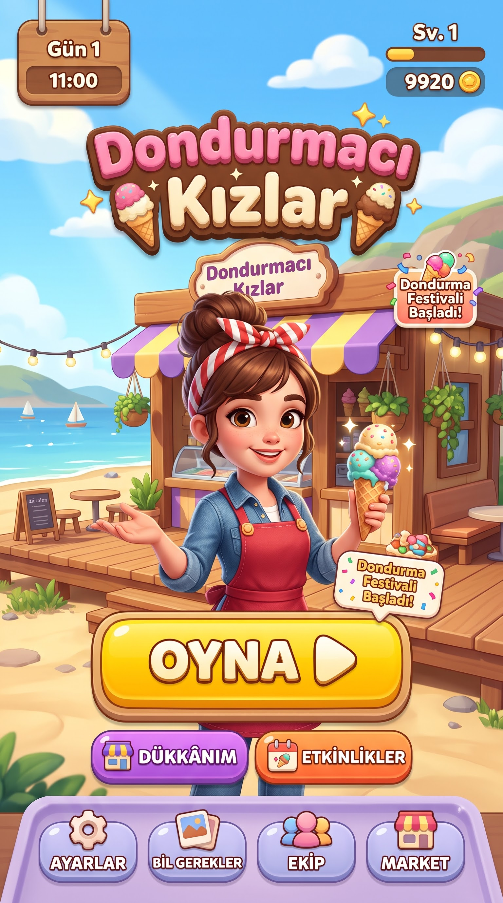
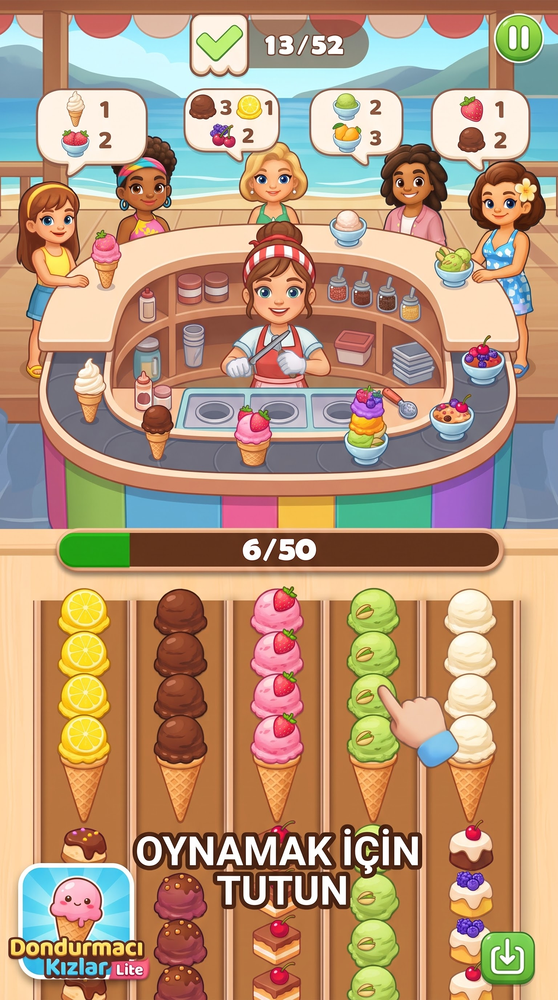
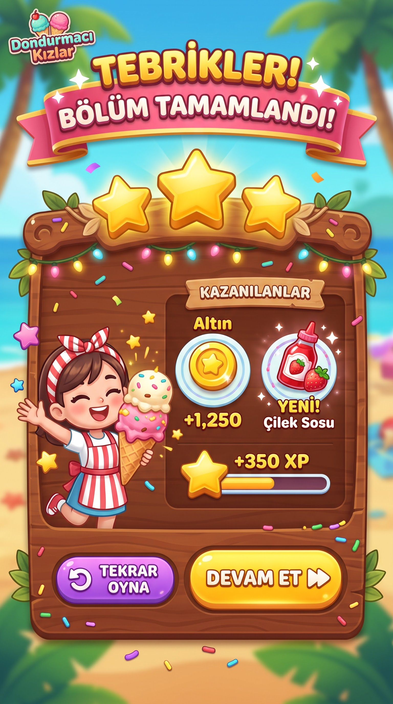
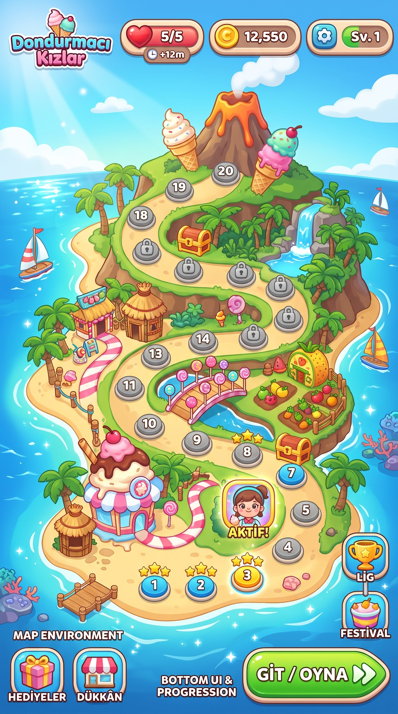

# DK Lite — Oyun Tasarım Belgesi (taslak)

**Proje:** DK Lite (Kems Company)
**Aşama:** Tasarım belgesi taslağı. Kod yok, depo yok.
**Taslağı yazan:** Oyun Şefi (Kems Ajans), 21 Ekim 2026. Onay Kemal'in.
**Yol haritası taslağı:** `docs/yol-haritasi.md`

Ne istendi: Kemal'in KKM'de doldurduğu DK Lite oyun dosyasından, Dondurmacı
Kızlar tasarım belgesinin bölüm düzeninde bir taslak. Kemal onaylayınca yeni
oyun deposuna `docs/tasarim-belgesi.md` olarak taşınır.

Bakılan kaynaklar:
- Kems-Ajans deposunda `isler/dk-lite/kkm-oyun-dosyasi-21-10-2026.pdf` (Kemal'in KKM'deki oyun dosyası, 2 sayfa; tam okundu)
- Kems-Ajans deposunda `isler/dk-lite/is-tarifi.md` (örnek oyun ekranının tarifi)
- KKM: `docs/02-marka-kiti.md`, `docs/03-duzada-kunyesi.md`
- Dondurmacı Kızlar deposu: `CLAUDE.md`, `docs/tasarim-belgesi.md`, `docs/yol-haritasi.md`, `docs/soru-cevap/acik-isler-1.md`

Ulaşılamayan: örnek oyunun ekran görüntüsü depoda yok; yalnız iş tarifindeki
yazılı anlatım kullanıldı.

Okuma kuralı: "[Kemal]" yazan yer Kemal'in dolduracağı boş alandır. "Öneri"
yazan her şey seçenektir, karar değildir. Hiçbir ad, slogan ya da hikâye
yazılmadı. Dondurmacı Kızlar oyununun ayarları (fiyat, süre, oran) buraya
taşınmadı.

---

## 0. Kararlar

### 0.1 Kemal'in KKM oyun dosyasında doldurdukları (21 Ekim 2026, olduğu gibi)

Künye ve konsept:
- Ad: DK Lite
- Tür: Bulmaca
- Platform: Mobil
- Hedef oyuncu: Sakin, rahat oynayan
- Oyuncu sayısı: Tek oyunculu
- Düzada'da nerede: Tek bir mekân
- Zaman aralığı: Tek bir sezon
- Kamera: 2D yandan
- Görsel stil: El çizimi 2D
- Oyun süresi: Sınırsız
- Takvim: Belirsiz
- Ekip: Tek kişi
- Özet: boş [Kemal]
- Açıklama: boş [Kemal]
- Tek cümlelik özet: Kaynak seçiminden sipariş karşılama

Dünya ve kurgu:
- Düzada'da nerede: Tek bir mekân
- Zaman aralığı: Tek bir sezon

Karakterler:
- Oyuncu kim: Adsız, oyuncunun kendisi

Mekanikler ve notlar:
- Bir oturum: 5–10 dakika
- Zaman nasıl akar: Bölüm bölüm
- Ana mekanikler: Envanter
- Kontrol: Dokunmatik

İlerleme ve ödül:
- Oyuncu ne kazanır: Hikâye bölümleri açılır, Başarımlar, Koleksiyon
- Oyunun sonu: Sonu yok (açık uçlu)

Arayüz:
- Kamera: 2D yandan

Görsel dil:
- Görsel stil: El çizimi 2D
- Palet: Marka paleti (lacivert, kiremit, krem)
- Ayrı bir satırda: "Düşük poligon 2D" (bkz. bölüm 7, çelişki)

Ses:
- Müzik: Lo-fi
- Seslendirme: Kısmi

Kapsam ve takvim:
- Oyun süresi: Sınırsız
- Takvim: Belirsiz
- Ekip: Tek kişi

Riskler:
- Motivasyon düşer, Finansman

Boş bırakılanlar:
- Fikir notları: boş [Kemal]
- Yapım aşaması ve işler: boş [Kemal]

### 0.2 Dondurmacı Kızlar deposunda geçen DK Lite kararları (21 Ekim 2026)

Bunlar Dondurmacı Kızlar deposunun açık işler soru turunda
(`docs/soru-cevap/acik-isler-1.md`, belge bölüm 0.16) Kemal'in verdiği
cevaplar. "DK" Dondurmacı Kızlar ise geçerlidir; değilse bu bölüm silinir
(bkz. Kemal'e sorular, 1. soru).

- Ayrı küçük oyun; kendi bağlantısı var, görseller ana oyunla ortak.
- Dik ekran, 2B çizim.
- Numaralı bölümler; her bölüm biraz daha zor, yıldız var.
- Oynanış: "Raftan gönder"; örnek Tasty Travels (adı ve görselleri kanon değil).
- Dondurma erir: "eriyen dondurma bir tur sonra yok olur". Kuralı bir öneri oyunu üzerinden konuşulacak.
- Can sistemi var (ana oyundan farklı). Sayıları o soru turunda yazılı; denemede can yok.
- Can bitince ne olacağı (bekleme ya da reklam) yayın döneminde konuşulacak.
- Deposu açık; Kemal karar verecek.

KKM dosyası ile bu kararlar arasında iki fark var, bölüm 7'de soru olarak duruyor:
görsel stil (ana oyunla "görseller ortak" ama KKM'de "el çizimi 2D") ve
palet (KKM'de marka paleti, kanonda dükkânın logo renkleri mor ve sarı).

---

### 0.3 Kemal'in taslak ekranları (21 Ekim 2026 akşam)

Kemal dört taslak ekran paylaştı (`docs/gorseller/kemal-taslak/`). Bunlar
yön gösteren taslaklardır; içlerindeki sayılar (altın, puan, can, bölüm
sayısı) ve İngilizce etiketler karar değildir.

- **Ana ekran:** "Dondurmacı Kızlar" yazısı, sahilde ahşap dükkân, mor-sarı
  çizgili tente, önde önlüklü dondurmacı kız; OYNA düğmesi; Dükkânım,
  Etkinlikler; altta Ayarlar, Bilgi/Galeri, Ekip, Market. Üstte gün ve saat,
  seviye, altın.
- **Oyun ekranı:** üstte beş müşteri, her birinin konuşma balonunda istediği
  çeşitler ve adetleri; ortada dondurmacı kızın durduğu yuvarlak tezgâh ve
  çevresinde dönen bant; altta beş sütun, her sütunda külah üstünde aynı
  çeşit toplar, altlarında pasta ve başka tatlılar. İki sayaç (karşılanan /
  toplam ve bir ilerleme çubuğu). Köşede "Dondurmacı Kızlar Lite" simgesi.
  **Bu, bölüm 3'teki Seçenek A'ya (dönen bant) uyuyor.**
- **Bölüm sonu:** "Bölüm tamamlandı", üç yıldız, kazanılanlar (altın ve
  yeni bir malzeme, ör. çilek sosu), deneyim çubuğu; Tekrar oyna, Devam et.
- **Bölüm haritası:** adada yukarı kıvrılan yol üstünde numaralı bölümler,
  kilitli olanlar, sandıklar; üstte can, altın, seviye; yanda Lig ve
  Festival; altta Hediyeler, Dükkân, Git / Oyna.

Ekranların cevapladığı (Kemal onaylarsa kesinleşir):
- "DK" Dondurmacı Kızlar; DK Lite onun hafif sürümü (simgede "Dondurmacı Kızlar Lite").
- Görsel stil: düşük poligon değil, yumuşak hatlı el çizimi 2D.
- Palet: dükkânın mor-sarısı ağırlıkta; marka paleti (lacivert, kiremit,
  krem) ekranlarda görünmüyor.
- Oynanış: Seçenek A, dönen bant ve sütunlar.
- Sakin oyuncu ile birlikte can, lig, festival, sandık da var.

Kanonla çelişebilecekler (karar Kemal'in):
- Bölüm haritasındaki adada yanardağ, palmiyeler ve tropik bitkiler var.
  Düzada bir Ege adası; künyede yanardağ geçmiyor. Harita Düzada mı olacak,
  yoksa oyunun kendi hayalî haritası mı?
- Dükkânın yeri: sahilde ahşap dükkân. Künyede dükkânın mahallesi yazıyorsa
  ona göre çizilmeli.

## 1. Oyunun özeti ve vizyonu

### 1.1 Tek cümlelik özet

Kaynak seçiminden sipariş karşılama. (Kemal'in cümlesi, olduğu gibi.)

Açıklama: [Kemal]

### 1.2 Temel tasarım sütunları (öneri, Kemal'in alanlarından çıkarıldı)

Yeni bilgi eklenmedi; Kemal'in doldurduğu alanlar üç başlıkta toplandı.

- **Sakin bulmaca:** hedef oyuncu "sakin, rahat oynayan". Zorluk acele etmekten değil, doğru sırayı düşünmekten gelir.
- **Kısa oturum:** bir oturum 5–10 dakika; oyun bölüm bölüm akar, her bölüm tek oturuma rahat sığar.
- **Biriktirme hissi:** sonu yok; oyuncu hikâye bölümleri, başarımlar ve koleksiyon biriktirir.

---

## 2. Ekranlar ve oynanış senaryoları

### 2.1 Örnek oyundaki kalıp (yalnız tür ve oynanış örneği)

Kemal'in paylaştığı ekran (Tasty Travels) şöyle çalışıyor. Görseli,
karakterleri ve adı DK Lite'a alınmaz; yalnız oynanış kalıbı örnektir.

- **Müşteriler (üstte):** tezgâhın çevresinde dört müşteri. Her birinin üstünde istediği ürün ve kaç tane istediği yazar.
- **Bant (ortada):** tezgâhın önünde dönen bir bant. Oyuncunun gönderdiği malzemeler bantta döner; isteyen müşteri kendi istediğini banttan alır.
- **Sütunlar (altta):** beş dikey sütun; her sütunda malzemeler üst üste dizili. Oyuncu bir sütuna dokunup tutunca o sütunun en üstündeki aynı türden malzemeler birlikte banda gider.
- **Sayaçlar (en üstte):** iki sayaç (görüntüde 13/52 ve 6/50). Ne saydıkları görüntüden kesin okunmuyor; büyük olasılıkla biri karşılanan sipariş, öbürü kalan malzeme ya da bant doluluğu. Tahmindir.

Bulmacanın özü: sütunların en üstü her an görünür ama altı kapalıdır. Oyuncu
yanlış sütunu açarsa bant istenmeyen malzemeyle dolar. Sakin ama düşündüren
bir "hangi sırayla?" sorusu.

### 2.2 Ekranlar (öneri)

- **Bölüm seçimi:** numaralı bölümler sırayla açılır; her bölümde kazanılan yıldız görünür.
- **Oyun ekranı (dik):** üstte müşteriler ve sayaçlar, ortada gönderme alanı (bant ya da tepsi, bkz. bölüm 3), altta sütunlar. "2D yandan" kamera: tezgâh ve müşteriler yandan görünür.
- **Bölüm sonu:** kaç yıldız, açılan hikâye bölümü ya da koleksiyon parçası varsa o.
- **Koleksiyon ve başarımlar:** ayrı bir sayfa. Neyin toplanacağı [Kemal].
- **Hikâye bölümleri:** açılan bölümün okunduğu / izlendiği sayfa. Metinleri [Kemal].

---

## 3. Ana mekanik: kaynak seçimi ve sipariş karşılama

Kemal'in "ana mekanik: envanter" seçimi ve "raftan gönder" kararı birlikte
düşünülünce üç yol çıkıyor. Hiçbiri seçilmedi; seçim Kemal'in. Hepsinde
sütunlar dondurmanın kendisi (kap, küvet ya da top) olabilir; ne olacağı
mekânın kararına bağlı.

### Seçenek A — Dönen bant (örneğe en yakın)

- Sütuna dokunup tut: en üstteki aynı çeşitler banda gider.
- Bant döner; istediği çeşit önünden geçen müşteri onu alır.
- Bantta yer sınırlı; bant dolunca bölüm zorlaşır ya da biter.
- Erime buraya kolay oturur: banda gönderilen dondurma bir tur içinde alınmazsa erir ve kaybolur (Kemal'in "bir tur sonra yok olur" cümlesine en yakın biçim).
- Artısı: örnekteki tanıdık his; Kemal'in DK'da seçtiği "raftan gönder"le birebir.
- Eksisi: dönen bant sürekli hareket ister; "sakin oyuncu" için hızı yavaş tutmak gerekir.

### Seçenek B — Envanter tepsisi (Kemal'in "envanter" seçimine en yakın)

- Bant yok; altta birkaç gözlü bir tepsi var.
- Sütuna dokunmak, en üstteki aynı çeşitleri tepsinin boş gözlerine koyar.
- Tepside bir müşterinin istediği tamamlanınca sipariş kendiliğinden gider.
- Tepsi dolar ve hiçbir siparişe uymazsa bölüm kaybedilir (ya da can gider).
- Erime saatle değil hamleyle: tepside bekleyen dondurma birkaç hamle sonra erir. Oyuncu dururken hiçbir şey erimez; bu sakin oyuncuya uyar.
- Artısı: süre baskısı yok, tamamen düşünme bulmacası; hareketli parça az, çizmesi kolay.
- Eksisi: örnekteki dönen bant hissi yok.

### Seçenek C — Hazırla ve ver (sonraki bölümler için)

- Sütunlarda yalnız çeşit değil, parçalar da var (külah, kap, top, sos gibi).
- Müşteri bir bileşim ister; oyuncu parçaları doğru sırayla tepsiye ya da banda gönderir.
- Artısı: Dondurmacı Kızlar'ın "kendi elinle hazırla" ruhuna yakın; ileri bölümlerde çeşitlilik verir.
- Eksisi: daha çok çizim ve daha karmaşık kural; ilk prototip için büyük.

Şefin notu (karar değil): ilk prototip için A ya da B küçük ve hızlı
denenir. C, A ya da B'nin üstüne sonradan eklenebilecek bir bölüm türü
olarak durabilir. Kemal isterse ilk prototipte A ve B yan yana açılıp
elde denenebilir; Dondurmacı Kızlar'da da erime kuralı "öneri oyunu
üzerinden konuşalım" diye kararlaştırılmıştı.

### 3.1 Sayaçlar (öneri)

Örnekteki iki sayaç gibi, oyuncu bölümün nerede olduğunu iki sayıdan görür.
Hangi ikisi olacağı seçilen seçeneğe bağlı:
- Karşılanan müşteri / bölümdeki toplam müşteri (her seçenekte)
- A'da: bant doluluğu. B'de: tepsideki boş göz. C'de: kalan parça.

---

## 4. İlerleme ve ödül

Kemal'in seçimi: hikâye bölümleri açılır, başarımlar, koleksiyon; sonu yok.

- **Bölümler ve yıldız:** her bölüm biraz daha zor; yıldız sayısı ve neye göre verildiği [Kemal] (öneri: kalan hamle ya da hiç erimeden bitirme gibi bir ölçü).
- **Hikâye bölümleri:** belirli bölümler geçilince bir hikâye parçası açılır. Kaç bölümde bir açılacağı ve metinleri [Kemal]. Metin gelene kadar yer tutucu kalır.
- **Başarımlar:** neler olacağı ve adları [Kemal].
- **Koleksiyon:** ne toplanacağı [Kemal]. Biçim seçenekleri (adsız): mekânın ürünleri, müşteri kartları, mekâna eklenen süs eşyaları.
- **Sonu yok:** elle yapılmış bölümler bitince ne olacağı açık (bkz. bölüm 7).
- **Can:** Dondurmacı Kızlar deposunda Kemal'in can kararı var; denemede can yok, ayrıntısı yayın dönemine.

---

## 5. Dünya ve kurgu

- **Yer:** Düzada'da tek bir mekân. Hangi mekân: [Kemal]. "DK" Dondurmacı Kızlar ise kanondaki yeri Liman Mahallesi, iskelenin yakını; dükkân 2000 sonrası açıldı.
- **Zaman:** tek bir sezon. Hangi sezon: [Kemal]. Kanonda Dondurmacı Kızlar kışın tatlıcı / kafe olur; tek sezon seçilirse bu ayrım oyunun dışında kalır.
- **Oyuncu:** adsız, oyuncunun kendisi (Kemal'in seçimi).
- **Mekânın adı:** [Kemal]
- **Karakterlerin adları (müşteriler, mekânın sahibi ve çalışanları):** [Kemal]
- **Ürün adları (çeşitler, koleksiyon parçaları):** [Kemal]
- **Hikâye bölümlerinin konusu ve metni:** [Kemal]
- Kanondan yalnız tutarlılık için: Dondurmacı Kızlar'ın sahibi bir kadındır, adı yoktur; Sade Meyhane'nin de sahibidir. Bu taslakta bu kişi hakkında başka bir şey yazılmadı.
- Kanon dışında Düzada bilgisi eklenmedi.

---

## 6. Görsel ve işitsel yönelim

- **Görsel stil:** El çizimi 2D (Kemal). Aynı dosyada "Düşük poligon 2D" satırı da var; hangisi olduğu bölüm 7'de soru.
- **Kamera:** 2D yandan. Dondurmacı Kızlar kararlarında dik ekran.
- **Palet:** marka paleti — krem `#F3EFE8`, lacivert `#0E1C4F`, kiremit `#F26B6F` (az). Kanonda Dondurmacı Kızlar'ın logo renkleri mor ve sarı; ikisinin nasıl birleşeceği soru.
- **Yazı tipi:** öneri Poppins (marka kiti: her yerde Poppins). Kemal onaylar.
- **Örnek oyundan alınmayacaklar:** görseller, karakterler, ad, yerleşimin birebir kopyası. Yalnız "sütun → gönderme alanı → müşteri" kalıbı alınır.
- **Müzik:** lo-fi (Kemal). Parçalar Kemal'in seçimi; prototipte geçici sessizlik ya da geçici ezgi.
- **Seslendirme:** kısmi (Kemal). Hangi satırların seslendirileceği ve kimin seslendireceği [Kemal].

---

## 7. Açık sorular

Karar Kemal'in; karar verilince bölüm 0'a taşınır.

- "DK" Dondurmacı Kızlar mı, DK Lite onun hafif sürümü mü? (Kemal'e sorular, 1)
- Görsel stil: "El çizimi 2D" mi, "Düşük poligon 2D" mi? İkisi aynı dosyada yazıyor ve birbirini tutmuyor. Dondurmacı Kızlar'da "görseller ortak" kararı da var; ana oyun 3B düşük poligon. (Kemal'e sorular, 2)
- Palet: marka paleti mi, dükkânın mor-sarısı mı, ikisi birlikte mi? (Kemal'e sorular, 2)
- Hangi oynanış seçeneği (A, B, C ya da A ile B'yi yan yana denemek)? (Kemal'e sorular, 3)
- Hangi mekân, hangi sezon.
- "Sakin oyuncu" ile can sistemi ve erime nasıl bağdaşacak (erime saatle mi, hamleyle mi)?
- Sonu yok: elle yapılmış bölümler bitince ne olur (kendiliğinden üretilen bölümler, günlük bölüm, ya da bekleme)?
- Hikâye bölümleri kaç bölümde bir açılır; metinleri ne zaman gelir?
- Koleksiyon ne toplar; başarımlar neler?
- Seslendirme hangi satırlarda?
- Para modeli (can bitince bekleme ya da reklam): yayın döneminde.
- Deposu: Kemal açacak.

### 7.1 Önerilen aralıklar (geçici, Kemal onaylar)

Hiçbiri karar değil; gerekçesiyle yalnız başlangıç önerisi. Prototipte elle
denenip değişir.

- **Bir bölümün süresi:** önerilen 1–3 dakika. Gerekçe: Kemal'in oturumu 5–10 dakika; bir oturuma birkaç bölüm sığarsa oyuncu her oturumda ilerleme görür.
- **Sütun sayısı:** önerilen 3–5 (ilk bölümlerde az, sonra artar). Gerekçe: dik telefon ekranında parmağın rahat dokunacağı genişlik; örnekte 5.
- **Aynı anda bekleyen müşteri:** önerilen 2–4. Gerekçe: örnekte 4; sakin oyuncu için ilk bölümlerde daha az.
- **İlk prototipteki bölüm sayısı:** önerilen 3–10 elle yapılmış bölüm. Gerekçe: zorluk artışını ve erimeyi denemeye yeter; daha fazlası prototipi büyütür.
- Can sayısı, dolma süresi, yıldız ölçüsü: Kemal'in kararı; bu taslak sayı önermez.

---

## 8. Yapım durumu

Uygulamada **olan**: hiçbir şey. Kod yok, depo yok.

Uygulamada **olmayan**: bu belgedeki her şey. Sıra yol haritası taslağında.

Yapım aşaması ve işler: [Kemal] (KKM'de boş; yol haritası taslağı onaylanınca dolabilir).

---

## Kemal'e sorular

1. Ekranlarına göre şunları kesinleştireyim mi: DK Lite, Dondurmacı Kızlar'ın hafif sürümü; el çizimi 2D; dükkânın mor-sarısı; oynanış Seçenek A (dönen bant)?
2. Bölüm haritası Düzada mı olacak? Ekrandaki yanardağ ve palmiyeler Ege adasıyla uyuşmuyor; Düzada'ya uyarlansın mı, yoksa oyunun kendi hayalî haritası mı kalsın?
3. Can, lig, festival, sandık ve market ilk sürümde olsun mu, yoksa ilk denemede yalnız bölüm, yıldız ve harita mı?
